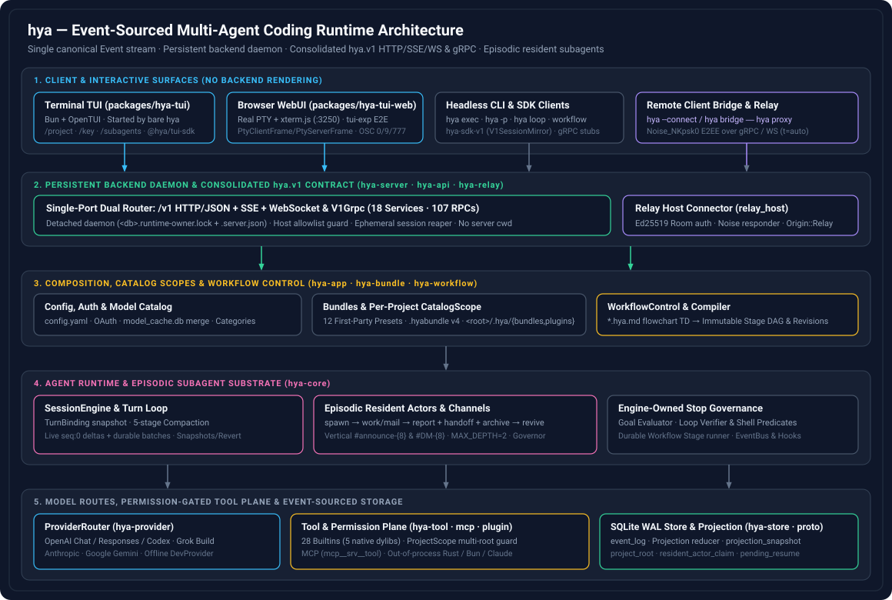

<p align="center">
  <br>
</p>

---

`hya` is an event-sourced, multi-agent coding agent written in Rust. It
normalizes OpenAI Chat/Responses/Codex, Grok Build, Anthropic Messages, and
Google Gemini routes into one canonical `Event` stream, executes 28 builtin tools
(plus MCP servers and out-of-process Rust/Bun/Claude bundle extensions) behind a
multi-root permission plane, and orchestrates episodic resident subagents and
compiled `Workflow` DAGs.

Every client speaks one consolidated contract — **`hya.v1`** (18 services, 107
RPCs) — served identically over HTTP/JSON + SSE + WebSocket (`/v1`) and gRPC on
a single port. Running bare `hya` in a terminal discovers or auto-starts the
database's persistent backend daemon and launches both the interactive
Bun/OpenTUI terminal frontend (`packages/hya-tui`) and the browser WebUI
(`packages/hya-tui-web` on `http://127.0.0.1:3250`). With no provider
configured, `hya` starts offline against its built-in echo provider
(`hya/offline`), so the entire stack runs out of the box without API keys.



## Status

`hya` is under active development (backend version `0.46.0`, frontend version
`0.44.23-dev.7`, minimum compatible backend `0.46.0`, licensed under
`MIT OR Apache-2.0`). Backend and frontend releases iterate independently via
`backend/<version>` and `frontend/<version>` tags.

## Quick Install

Install the latest backend and frontend releases (including a bundled Bun
runtime) into `$HOME/.local`:

```sh
curl -fsSL https://hya.ed-aisys.com/install.sh | sh
export PATH="$HOME/.local/bin:$PATH"   # if not already on PATH
hya                                    # Terminal TUI here + WebUI on http://127.0.0.1:3250
```

Update or install a single side (`--backend-only` for headless servers,
`--tui-only` for the TUI/WebUI):

```sh
hya update
hya update --backend-only
hya update --tui-only
```

To build and install from a source checkout instead (requires Rust `1.91`+, Git,
and Bun `1.4.2`+):

```sh
./install.sh --prefix "$HOME/.local"
export PATH="$HOME/.local/bin:$PATH"
```

See [Quick Start Guide](docs/getting-started.md) and
[Install and Update](docs/install.md) for platform targets, WSL 2, and version
pinning.

## Run `hya` & Configure a Provider

Launch the interactive TUI and browser WebUI:

```sh
hya                # Terminal TUI + WebUI on http://127.0.0.1:3250
hya --port 8000    # Custom WebUI port
hya --resume       # Pick and resume a session in the current Project
```

The detached backend daemon keeps running after `/exit` so reconnects are
instant (`hya serve status|stop|restart`). Add a live model provider via the
guided CLI (or `/key` inside the TUI):

```sh
hya provider add                                       # guided base URL, protocol, API key
hya oauth login --provider codex --type openai-codex   # or ChatGPT Codex / Grok Build OAuth
hya models                                             # inspect resolved model catalog
```

Or configure `~/.config/hya/config.yaml` directly:

```yaml
default_model: anthropic/claude-sonnet-4-6
providers:
  anthropic:
    kind: anthropic
    base_url: https://api.anthropic.com/v1
    api_key: "{env:ANTHROPIC_API_KEY}"
    models: [claude-sonnet-4-6]
```

Headless and remote commands:

```sh
hya exec "summarize this repository"
hya -p "make all unit tests pass" --max-iterations 6
hya loop --target "clean clippy" --until "cargo clippy --workspace -- -D warnings"
hya --connect -    # connect TUI + WebUI to a remote backend over a Noise_NKpsk0 relay link
```

## Documentation

Full documentation lives in **[docs/README.md](docs/README.md)**, organized into
three core categories:

| Category | Key Documents |
| --- | --- |
| **1. Design Philosophy & Architecture** | [Design Philosophy & Architecture Overview](docs/architecture/overview.md) · [Project Structure](docs/project-structure.md) · [Domain Glossary (`CONTEXT.md`)](CONTEXT.md) · [Runtime](docs/architecture/runtime.md) · [Event Model](docs/architecture/event-model.md) · [Subagent Orchestration](docs/architecture/subagent-orchestration.md) · [Storage](docs/architecture/storage.md) · [Server & Client](docs/architecture/server-client.md) · [ADRs](docs/adr/) |
| **2. Usage Guides: Quick Start & Configuration** | [Quick Start Guide](docs/getting-started.md) · [Configuration Guide](docs/configuration.md) · [Install & Update](docs/install.md) · [CLI Reference](docs/cli.md) · [OpenTUI Frontend](docs/tui.md) · [WebUI (`hya-tui-web`)](docs/tui-web.md) · [Secure Relay](docs/relay.md) · [Workflows](docs/workflows.md) · [Bundle Authoring](docs/agent-bundle-authoring.md) · [Troubleshooting](docs/troubleshooting.md) |
| **3. Architecture & Design Diagrams** | [Architecture & Design Diagrams](docs/architecture/diagrams.md) · [System Blueprint SVG](docs/assets/hya-architecture.svg) · [v1 Protocol Guide](docs/protocol/README.md) · [Generated API Reference](docs/protocol/api-reference.md) |

## License

Licensed under either `MIT` or `Apache-2.0` at your option. Consult the
repository license files and `THIRD_PARTY_NOTICES` for complete terms.
