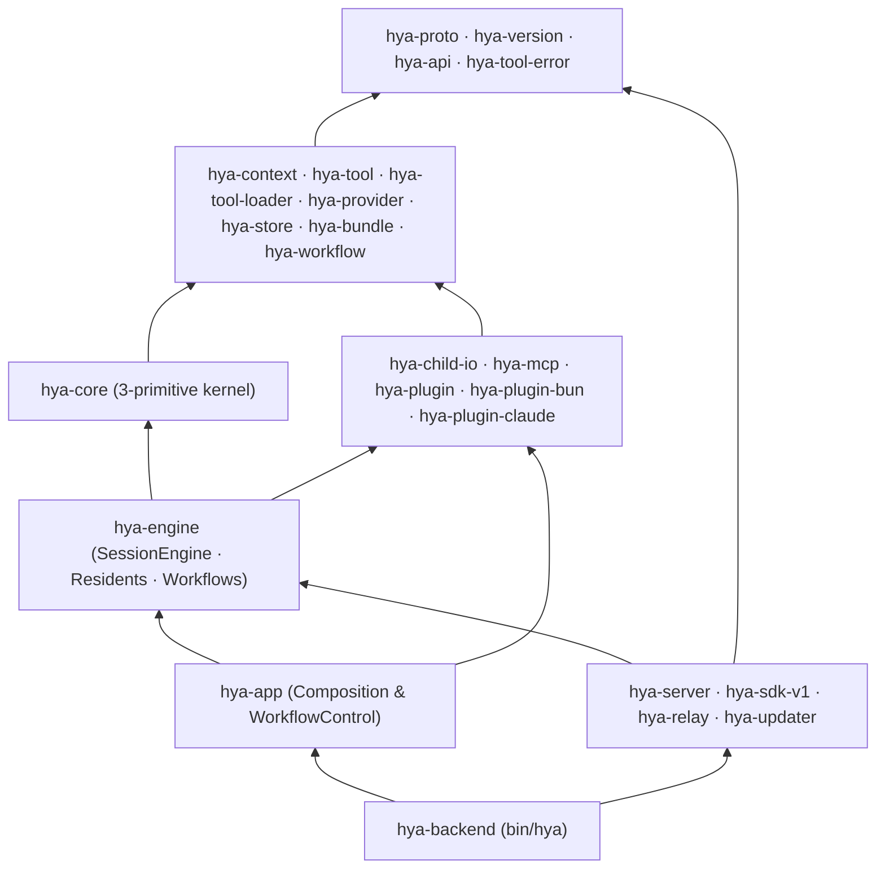

# Repository & Crate Map

Use this page to navigate the repository and quickly find which crate or package owns a change.

---

## Top-level directory layout

```text
hya/
├── crates/                  # Rust workspace crates (backend, kernel, engine, store, server, SDK, relay, xtask, e2e)
├── bundles/
│   ├── presets/             # Trusted first-party bundles (4 native tool families, core-agents, skills, commands, channels)
│   ├── internal/            # Internal full-mode native bundles (hya/compaction)
│   ├── first-party/         # Additional shipped first-party bundles (goal-loop, plan-impl-review, basic-tui-components, code-mode)
│   ├── extra/               # Optional installable hya-extra/* bundles (zvec-grep, scout, jev-model-router, model-fallback, token-summary, orchestrator)
│   └── examples/            # Full Argus multi-stage workflow bundle example
├── packages/
│   ├── hya-tui/             # Interactive Bun/OpenTUI terminal frontend
│   ├── hya-tui-web/         # Real-PTY + xterm.js browser WebUI host & tui-exp / Playwright test suites
│   └── hya-tui-sdk/         # Standalone @hya/tui-sdk package & QuickJS WASM / JIT extension runner
├── proto/
│   ├── hya/v1/              # Canonical hya.v1 Protobuf contract (18 services, 109 RPCs)
│   └── hya/relay/v1/        # Blind relay rendezvous Protobuf contract
├── plugins/                 # Standalone full-stack example plugins (e.g. disk-inspector)
├── public/                  # Static GitHub Pages root landing page (plain HTML/CSS/JS)
├── scripts/                 # Unified release installer (hya-install.sh) & developer utilities
├── docs/                    # Documentation & Astro Starlight site (docs/site/)
├── CONTEXT.md               # Root domain glossary
└── versions.toml            # Single source of truth for release version & minimum_backend_version
```

---

## Rust workspace crates (`crates/`)

Lower-level crates never depend on `hya-backend` or frontend packages. `hya-proto` stays dependency-light, and `hya-relay` and `hya-updater` do not depend on runtime crates.

| Crate | Role |
| --- | --- |
| **`hya-proto`** | Newtyped IDs (`SessionId`, `MessageId`, …), canonical `Event` / `Envelope`, message parts, DTOs, and the deterministic `Projection` reducer. |
| **`hya-version`** | Compile-time `VERSION` and `MINIMUM_BACKEND_VERSION` read from `versions.toml`. |
| **`hya-api`** | Generated `proto/hya/v1` types (`prost` / `tonic` / `pbjson`), cursor helpers, and HTTP ↔ gRPC error-code table (`xtask -- gen-api`). |
| **`hya-context`** | Token estimation, context-window accounting, and the `Rewriter` trait used by context-reduction extensions. |
| **`hya-tool-error`** | Shared tool and permission error types across host and native libraries. |
| **`hya-tool`** | `Tool` trait, `ToolRegistry`, `PermissionPlane`, symlink-safe multi-root `ProjectScope`, session planes (interaction, spawn, skill, LSP, workflow), and lockstep native ABI v1. |
| **`hya-tool-loader`** | Verifies and loads the four native tool-family dynamic libraries (`base`, `extended`, `network`, `channel`) against `exposure.yaml` policies. |
| **`hya-provider`** | Streams OpenAI Chat, OpenAI Responses, OpenAI Codex, Grok Build, Anthropic, Google Gemini, scripted `FakeProvider`, and offline `DevProvider` into canonical `Event`s. |
| **`hya-store`** | SQLite WAL persistence: `event_log`, `projection_snapshot`, `project`/`project_root`, `resident_actor_claim`, `pending_resume`, `saved_permission`, `file_blob`, and `<db>.runtime-owner.lock`. |
| **`hya-bundle`** | `.hyabundle` preparation, digest/closure validation (format v4), `BundleCatalog`, and loader for the 13 trusted first-party bundles. |
| **`hya-workflow`** | Parses, validates, and compiles `*.hya.md` Stage DAGs into immutable `CompiledWorkflow` plans. |
| **`hya-child-io`** | Bounded NDJSON line framing and async I/O task tracking shared by MCP and plugin child processes. |
| **`hya-mcp`** | MCP stdio, Streamable HTTP, and SSE client manager bridging `mcp__<server>__<tool>` into `hya-tool`. |
| **`hya-plugin`** | Out-of-process NDJSON JSON-RPC 2.0 plugin host, hook chain dispatcher, permission bridge, and `host/capability` handler. |
| **`hya-plugin-bun`** | Bun JS extension adapter (`adapter/`), translating high-level JS tool/hook modules onto the JSON-RPC stdio wire. |
| **`hya-plugin-claude`** | Claude Code plugin importer (`--claude`) and runtime hook adapter (`adapter/`). |
| **`hya-core`** | The three-primitive `kernel` loop (`hya exec --bare`), kernel prompt builder, 80% `Rewrite` trigger, and internal native bundle loader (`bundles::load_internal`). |
| **`hya-engine`** | Full-mode `SessionEngine`, `TurnBinding`, Goal/Loop drivers, `ResidentSupervisor`, `SubagentGovernor`, vertical mailbox/channel service, Workflow DAG runner, and lazy `CatalogScope` overlays. |
| **`hya-app`** | Runtime composition: `config.yaml` & OAuth loading, model cache merge, project bundle/plugin watchers, LSP/formatter setup, `WorkflowControl`, and `HyaRuntime` shutdown orchestration. |
| **`hya-server`** | Single-port `/v1` Axum HTTP/SSE/WS router + `V1Grpc`, Host allowlist guard, ephemeral session reaper, and `relay_host` connector. |
| **`hya-sdk-v1`** | Typed Rust `/v1` HTTP + SSE client (`V1Sdk`, `Client`) and `V1SessionMirror` transcript reducer. |
| **`hya-relay`** | Standalone `hya.relay.v1` protocol, `RelayLink` parser, `Noise_NKpsk0` tunnel, stateless room `proxy`, and gRPC + WebSocket client/server bindings. |
| **`hya-updater`** | Standalone release updater embedding `scripts/hya-install.sh` for `hya update`. |
| **`hya-backend`** | Unified `hya` CLI binary: subcommand dispatch, ACP v1 stdio adapter (`acp/`), detached daemon manager (`daemon.rs`), and Bun TUI/WebUI process supervisor (`frontend.rs`). |
| **`hya-e2e`** | Process-level E2E test harness (Track P: real `hya` binary + scripted `FakeLlm`, registered in `matrix.toml`). |
| **`xtask`** | Developer CLI for `gen-api`, `gen-relay`, `gen-plugin`, `package-bundle`, `matrix-check`, benchmarks, and `release-rehearsal`. |

---

## Crate dependency flow



---

## "Where should my change go?"

| If you are changing... | Edit here |
| --- | --- |
| A wire `Event`, ID type, or `Projection` folding rule | `crates/hya-proto` |
| A `/v1` HTTP route, gRPC method, or error code | `proto/hya/v1/*.proto` → run `cargo run -p xtask -- gen-api` → `crates/hya-server` |
| An LLM provider encoder/decoder or capability check | `crates/hya-provider` |
| One of the 6 bare-mode kernel tools or `Rewrite` rules | `crates/hya-core/src/kernel` |
| One of the 25 full-mode built-in tools | `bundles/builtin/{base,extended,network,channel}-tools/native` |
| Permission rules, `ProjectScope`, or the `Tool` trait | `crates/hya-tool` |
| `shake` or `remote` context compaction | `bundles/builtin/compaction/native` |
| SQLite tables, migrations, locks, or event batching | `crates/hya-store` |
| `.hyabundle` manifest parsing or validation | `crates/hya-bundle` |
| `*.hya.md` Workflow syntax or DAG compilation | `crates/hya-workflow` |
| Turn loops, subagent episodes, channels, or Workflow execution | `crates/hya-engine` |
| `config.yaml` loading, OAuth, or Project catalog refresh | `crates/hya-app` |
| CLI flags, daemon start/stop, or bare `hya` process launch | `crates/hya-backend` |
| TUI screens, slash commands, keybindings, or `tui.toml` | `packages/hya-tui` |
| Browser WebUI host or PTY test runner | `packages/hya-tui-web` |
| TUI extension API or QuickJS VM sandbox | `packages/hya-tui-sdk` |
