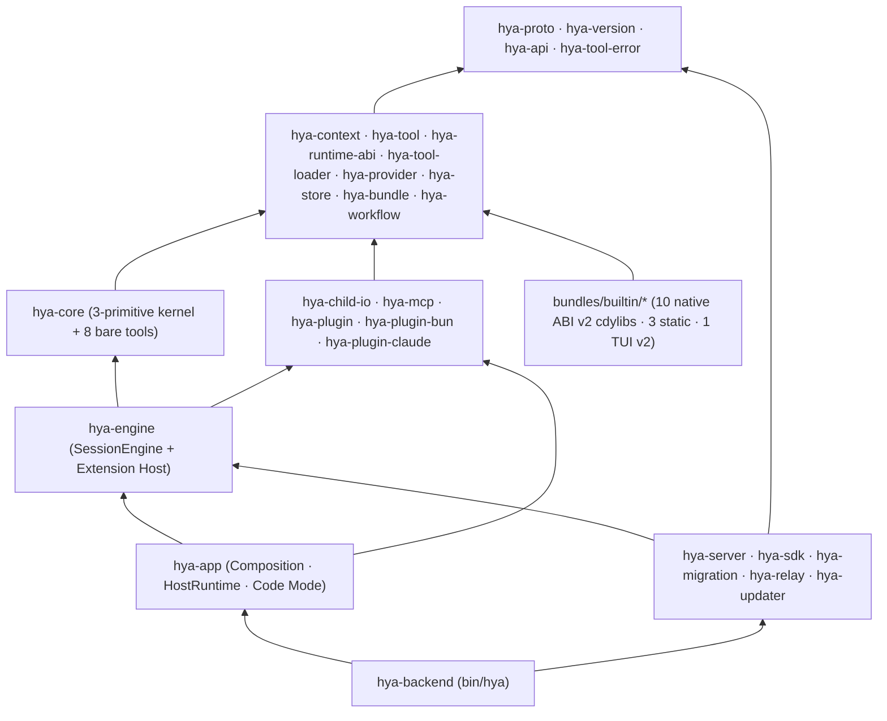

# Repository & Crate Map

Use this page to navigate the repository and quickly find which crate, built-in bundle, or package owns a change.

---

## Top-level directory layout

```text
hya/
├── crates/                  # Rust workspace crates (backend, kernel, runtime-abi, engine, store, server, SDK, migration, relay, xtask, e2e)
├── bundles/
│   ├── builtin/             # 14 trusted first-party bundles (10 native ABI v2, 3 static presets, 1 JS/TUI v2)
│   ├── extra/               # 6 optional installable hya-extra/* bundles (zvec-grep, scout, jev-model-router, model-fallback, token-summary, orchestrator)
│   └── examples/            # Full Argus multi-stage workflow bundle example
├── packages/
│   ├── hya-code-mode/       # Core Code Mode JS runtime (promoted into hya-bare)
│   ├── hya-tui/             # Interactive Bun/OpenTUI terminal frontend (hya.v2)
│   ├── hya-tui-web/         # Real-PTY + xterm.js browser WebUI host & tui-exp / Playwright test suites
│   └── hya-tui-sdk/         # Standalone @hya/tui-sdk v2 package & QuickJS WASM / JIT extension runner
├── proto/
│   ├── hya/v2/              # Canonical hya.v2 Protobuf contract (17 services, 104 RPCs)
│   └── hya/relay/v1/        # Blind relay rendezvous Protobuf contract
├── plugins/                 # Standalone full-stack example plugins (e.g. disk-inspector)
├── public/                  # Static GitHub Pages root landing page (plain HTML/CSS/JS)
├── scripts/                 # Unified release installer (hya-install.sh), bundle-ci, & developer utilities
├── docs/                    # Documentation & Astro Starlight site (docs/site/)
├── CONTEXT.md               # Root domain glossary
└── versions.toml            # Single source of truth for release version & minimum_backend_version
```

---

## Rust workspace crates (`crates/`)

Lower-level crates never depend on `hya-backend` or frontend packages. `hya-proto` stays dependency-light, `hya-runtime-abi` carries zero store/engine/server dependencies, and `hya-relay` and `hya-updater` do not depend on runtime crates.

| Crate | Role |
| --- | --- |
| **`hya-proto`** | Newtyped IDs (`SessionId`, `MessageId`, …), canonical kernel `Event` + `Event::Extension` / `Envelope`, message parts, DTOs, and the deterministic `Projection` reducer (with `Projection::extensions`). |
| **`hya-version`** | Compile-time `VERSION`, `BACKEND_VERSION`, `RUSTC`, and `MINIMUM_BACKEND_VERSION` read from `versions.toml`. |
| **`hya-api`** | Generated `proto/hya/v2` types (`prost` / `tonic` / `pbjson`), cursor helpers, and HTTP ↔ gRPC error-code table (`xtask -- gen-api`). |
| **`hya-context`** | Token estimation, context-window accounting, and the `Rewriter` trait used by context-reduction extensions. |
| **`hya-tool-error`** | Shared tool and permission error types across host and native libraries. |
| **`hya-tool`** | `Tool` trait, `ToolRegistry` (enforcing permanently reserved `todo`/`rewrite`), `PermissionPlane`, symlink-safe multi-root `ProjectScope`, `HandleRouter` (`DynamicUriHandler`), slim single-agent `ToolCtx` + `ExtensionPlanes` (`ErasedPlane`), and lockstep ABI helpers. |
| **`hya-runtime-abi`** | Lockstep Native Runtime ABI v2 (`export_native_bundle_v2!`, `abi_digest_v2`, `NativePluginContext`, `NativeRegistrations`, `Arc<dyn HostRuntime>` + 7 sub-traits, and native extension traits; see **[Native Bundle Runtime ABI v2](../extend/native-abi.md)**). |
| **`hya-tool-loader`** | Verifies lockstep ABI v2 digests and loads the 10 first-party native `cdylib` bundles (`load_v2`, `NativeBundleLoader`) into `NativeRegistrations` with Tokio runtime & deadline-cell bridging. |
| **`hya-provider`** | Streams OpenAI Chat, OpenAI Responses, OpenAI Codex, Grok Build, Anthropic, Google Gemini, scripted `FakeProvider`, and offline `DevProvider` into canonical `Event`s. |
| **`hya-store`** | SQLite WAL v2 persistence (`format_version = 2`): `schema_meta`, `event_log`, `projection_snapshot`, `project`/`project_root`, generic `bundle_state` (CAS KV), generic `bundle_claim` (fenced leases), `pending_resume`, `saved_permission`, `file_blob`, and `<db>.runtime-owner.lock`. Fails fast on unmigrated v1 databases. |
| **`hya-bundle`** | `.hyabundle` `schema_version: 2` preparation, `overrides: hya/bare` resolution, `BuiltinBundleProfile`/`BuiltinBundleSelection`, digest/closure validation, `BundleCatalog`, and loader for the 14 trusted built-in bundles. |
| **`hya-workflow`** | Parses, validates, and compiles `*.hya.md` Stage DAGs into immutable `CompiledWorkflow` plans (executed at runtime by `bundles/builtin/workflow`). |
| **`hya-child-io`** | Bounded NDJSON line framing and async I/O task tracking shared by MCP and plugin child processes. |
| **`hya-mcp`** | MCP stdio, Streamable HTTP, and SSE client manager bridging `mcp__<server>__<tool>` into `hya-tool`. |
| **`hya-plugin`** | Out-of-process NDJSON JSON-RPC 2.0 plugin host, hook chain dispatcher, permission bridge, and `host/capability` handler. |
| **`hya-plugin-bun`** | Bun JS extension adapter (`adapter/`), translating high-level JS tool/hook modules onto the JSON-RPC stdio wire. |
| **`hya-plugin-claude`** | Claude Code plugin importer (`--claude`) and runtime hook adapter (`adapter/`). |
| **`hya-core`** | The three-primitive `kernel` loop (`read`, `write`, `edit`, `bash`, `grep`, `todo`, `rewrite`, plus built-in `skill`), kernel prompt builder, and 80% `Rewrite` trigger. Loads and links no bundle (ADR-0040). |
| **`hya-engine`** | Slimmed single-agent `SessionEngine` + extension host adapters (`TurnBinding`, `CatalogScope` overlays, `NativeService`/`NativeHook`/`ProjectionReducer` wiring, and one kernel harness for all profiles). |
| **`hya-app`** | Runtime composition: `config.yaml` (`schema_version: 2`) & per-bundle `config.yml`, OAuth/provider loading, core `code_mode` adapter (`packages/hya-code-mode`), `HostRuntime` implementation, project bundle/plugin watchers, and `HyaRuntime` shutdown orchestration. |
| **`hya-server`** | Single-port `/v2` Axum HTTP/SSE/WS router + `V2Grpc` (`BundleApi` mounting native + JS handlers), Host allowlist guard, ephemeral session reaper, and `relay_host` connector. |
| **`hya-sdk`** | Typed Rust `/v2` HTTP + SSE client (`Sdk`, `Client`) and `SessionMirror` transcript + `extensions` reducer. |
| **`hya-migration`** | Standalone offline v1-to-v2 migration & SHA-256 rollback CLI (`bin/hya-migration`) for `sessions.db`, `config.yaml`, `tui.toml`, `tui.json`, `.hya/bundles/`, and `registry.sqlite3` (see **[Migrating v1 to v2](../guide/migration-v1-to-v2.md)**). |
| **`hya-relay`** | Standalone `hya.relay.v1` protocol, `RelayLink` parser, `Noise_NKpsk0` tunnel, stateless room `proxy`, and gRPC + WebSocket client/server bindings. |
| **`hya-updater`** | Standalone release updater embedding `scripts/hya-install.sh` for `hya update`. |
| **`hya-backend`** | Unified `hya` CLI binary: global `--bare`/`--pure`, subcommand dispatch (`exec`, `-p`, `loop`, `workflow`, `serve`, `bundle`, `relay`, `acp`), detached daemon manager (`daemon.rs`), and Bun TUI/WebUI process supervisor (`frontend.rs`). |
| **`hya-e2e`** | Process-level E2E test harness (Track P: real `hya` binary + scripted `FakeLlm`, registered in `matrix.toml`). |
| **`xtask`** | Developer CLI for `gen-api`, `gen-relay`, `gen-plugin`, `package-bundle`, `matrix-check`, benchmarks, and `release-rehearsal`. |

---

## Crate dependency flow



---

## "Where should my change go?"

| If you are changing... | Edit here |
| --- | --- |
| A wire `Event` / `Event::Extension`, ID type, or `Projection` folding rule | `crates/hya-proto` |
| A `/v2` HTTP route, gRPC method, or error code | `proto/hya/v2/*.proto` → run `cargo run -p xtask -- gen-api` → `crates/hya-server` |
| Lockstep Native ABI v2 traits, `HostRuntime`, or `export_native_bundle_v2!` | `crates/hya-runtime-abi` (and `crates/hya-tool-loader` / `crates/hya-app/src/host_runtime.rs`) |
| An LLM provider encoder/decoder or capability check | `crates/hya-provider` |
| One of the 8 bare-mode core tools (`read`/`write`/`edit`/`bash`/`grep`/`todo`/`rewrite`/`skill`) or `Rewrite` rules | `crates/hya-core/src/kernel` |
| Core Code Mode runtime | `packages/hya-code-mode` + `crates/hya-app/src/code_mode.rs` |
| Hashline file tools, LSP/formatters, web tools, plan mode, goal/loop drivers, subagents, channels, workflows, or compaction | `bundles/builtin/{hashline,coding-extras,network,plan,goal,loop,multi-agent,agent-channels,workflow,compaction}/native` |
| Permission rules, `ProjectScope`, `HandleRouter`, `ExtensionPlanes`, or the `Tool` trait | `crates/hya-tool` |
| SQLite v2 tables, migrations, locks, `bundle_state`/`bundle_claim`, or event batching | `crates/hya-store` |
| Offline v1-to-v2 migration or SHA-256 rollback | `crates/hya-migration` |
| `.hyabundle` `schema_version: 2` manifest parsing or validation | `crates/hya-bundle` |
| `*.hya.md` Workflow syntax or DAG compilation | `crates/hya-workflow` |
| Single-agent turn loops or extension host wiring | `crates/hya-engine` |
| `config.yaml` v2 loading, per-bundle `config.yml`, OAuth, or Project catalog refresh | `crates/hya-app` |
| CLI flags (`--bare`, `--pure`), daemon start/stop, or bare `hya` process launch | `crates/hya-backend` |
| TUI core shell, slash commands, keybindings, or `tui.toml` | `packages/hya-tui` (and built-in TUI bundles under `bundles/builtin/*/tui/`) |
| Browser WebUI host or PTY test runner | `packages/hya-tui-web` |
| `@hya/tui-sdk` v2 extension API or QuickJS VM sandbox | `packages/hya-tui-sdk` |
