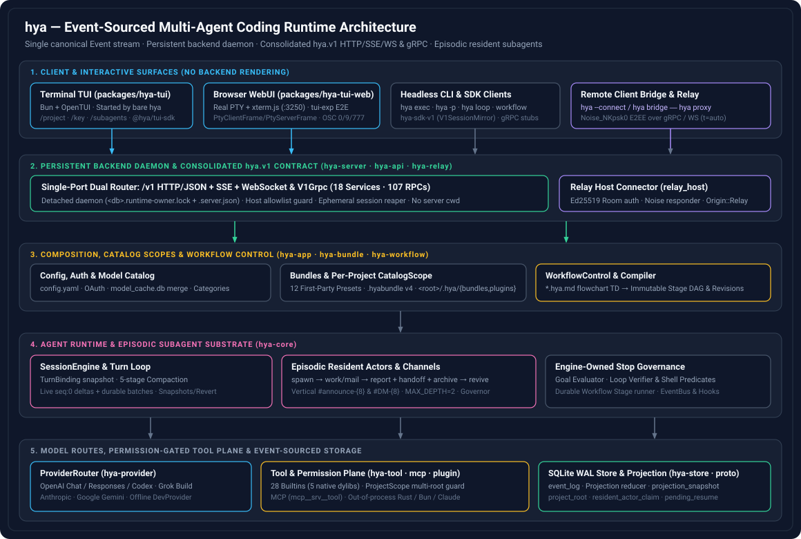
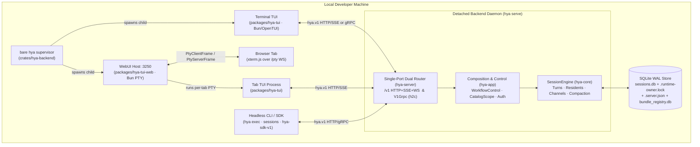
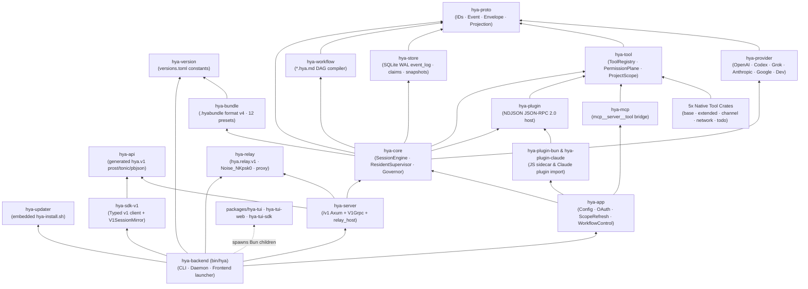
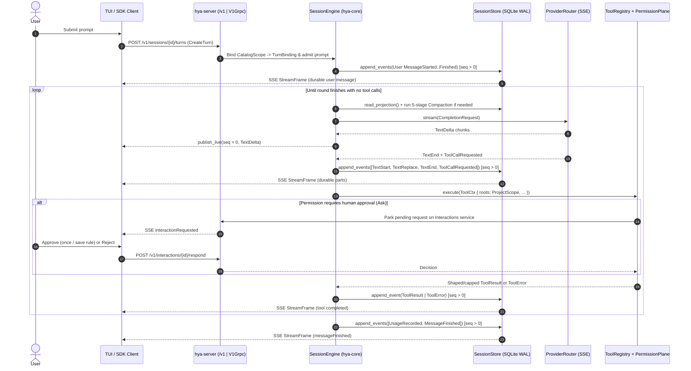
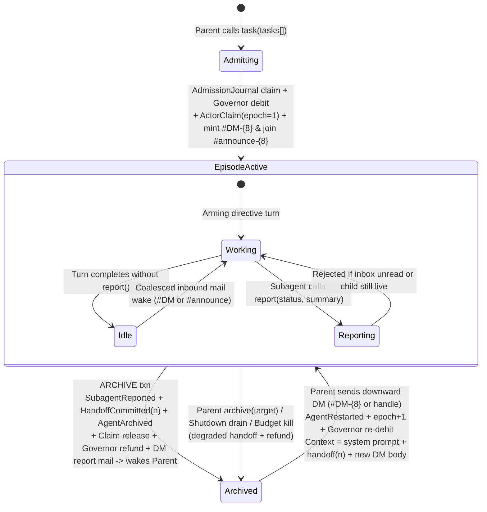
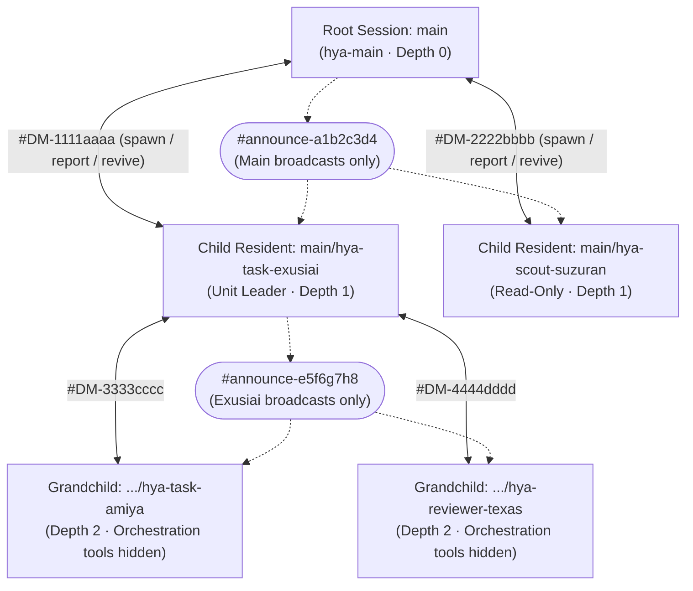
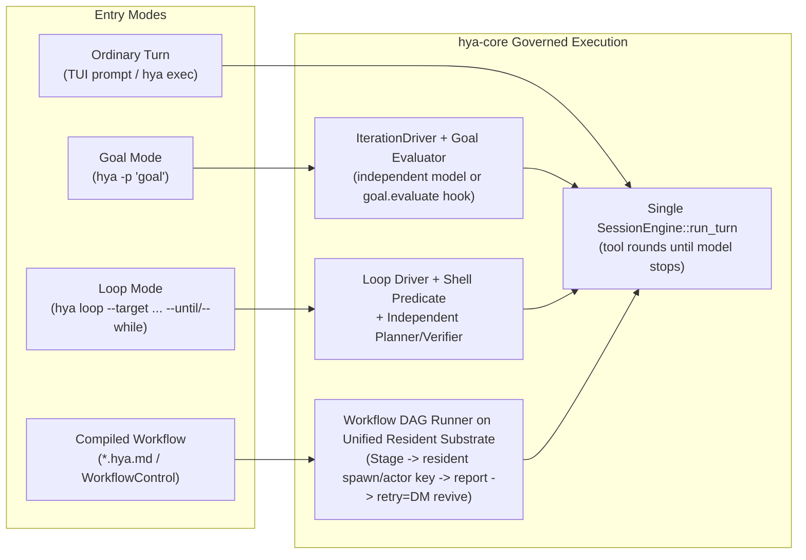
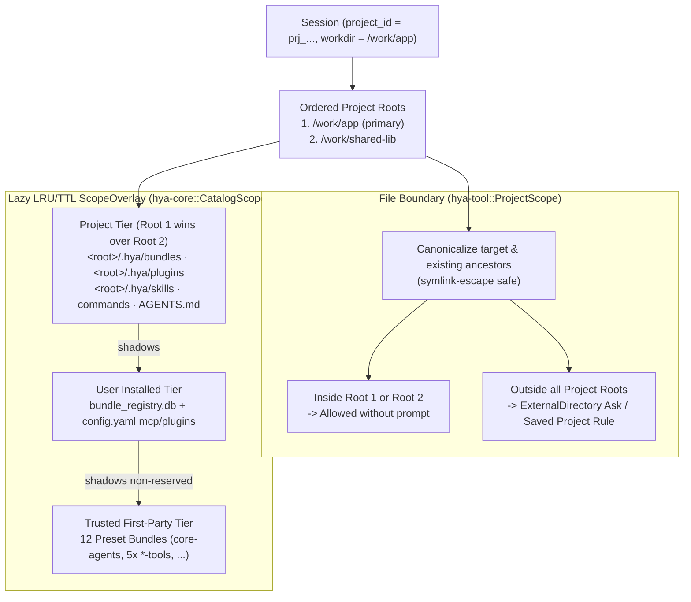

# Architecture & Design Diagrams

This page collects visual architecture diagrams for `hya`'s current system
structure, crate boundaries, event-sourced turn pipeline, episodic subagent
lifecycle, governed Workflows, multi-root Projects, zero-trust Relay, and
hot-reload/restart model.

For narrative rationale and crate-level invariants, pair this document with
[Design Philosophy & Architecture Overview](overview.md) and
[Project Structure](../project-structure.md).

---

## 1. High-Level System Architecture Blueprint



### Event-Sourced Turn Pipeline & Dual-Track Streaming Blueprint


### Episodic Subagents, Vertical Channels & Secure Relay Blueprint


---

## 2. Process Topology, Persistent Daemon & Client Surfaces

Bare `hya` never renders in Rust and never embeds an in-process server. Instead,
it discovers or auto-starts the database's detached **backend daemon**
([ADR-0022](../adr/0022-one-writer-per-database.md),
[ADR-0023](../adr/0023-persistent-backend-daemon.md)) and supervises the
Bun/OpenTUI terminal UI and the browser WebUI PTY host
([ADR-0018](../adr/0018-browser-rendered-tui-test-environment.md),
[ADR-0020](../adr/0020-bundle-tui-and-webui-in-hya.md)).



---

## 3. Workspace Crate & Package Dependency Graph

Lower crates never depend on `hya-backend` or UI packages; `hya-proto` stays free
of async/SQL/HTTP dependencies, and `hya-relay` and `hya-updater` remain isolated
from runtime crates.



---

## 4. Single-Turn Event-Sourced Execution & Streaming Sequence

High-frequency text deltas stream live at `seq = 0` without disk writes; part
boundaries commit durable batches (`seq > 0`), and permission `Ask`s park on the
`Interactions` plane without blocking unrelated sessions.



---

## 5. Episodic Resident Subagent Lifecycle & Vertical Channel Plane

Every spawned subagent is an episodic resident actor
([ADR-0015](../adr/0015-unified-resident-subagent-lifecycle.md),
[ADR-0016](../adr/0016-channel-communication-plane.md)). Tree depth is capped at
`MAX_SUBAGENT_DEPTH = 2`, siblings never see each other, and archived actors
consume zero tokens until revived by a downward DM from their parent.



Vertical Team Topology (`MAX_SUBAGENT_DEPTH = 2`):



---

## 6. Governed Execution Modes (Turn vs Goal vs Loop vs Workflow DAG)

Workers never decide that their own multi-step objective is complete. Stop
decisions belong to `hya-core` evaluators, verifiers, and `WorkflowControl`
([ADR-0013](../adr/0013-user-assembled-agent-workflows.md),
[ADR-0017](../adr/0017-workflow-on-unified-substrate.md)).



---

## 7. Multi-Root `Project`, `ProjectScope` & Lazy `CatalogScope`

`hya serve` has no process `cwd`
([ADR-0024](../adr/0024-project-model-and-client-chosen-workspace.md),
[ADR-0026](../adr/0026-multi-root-path-permissions.md),
[ADR-0027](../adr/0027-per-project-catalog-tier.md)). Both file permissions and
bundle/plugin catalogs derive from the Session's `Project`.



---

## 8. Zero-Trust End-to-End Encrypted Relay (`hya.relay.v1` + `Noise_NKpsk0`)

The `hya proxy` relay holds no keys and sees only Room IDs, stream IDs, and
ciphertext ([ADR-0025](../adr/0025-secure-relay.md)). Loopback-only RPCs
(`RelayControl`) are rejected on `Origin::Relay`.

```mermaid
sequenceDiagram
    autonumber
    participant TUI as Local TUI / WebUI
    participant Bridge as Local hya bridge<br/>(127.0.0.1:ephemeral)
    participant Proxy as Untrusted hya proxy<br/>(Stateless Room Rendezvous)
    participant Host as Backend relay_host<br/>(inside hya serve)
    participant V1 as hya.v1 Router<br/>(Origin::Relay)

    Host->>Proxy: RegisterRoom (Ed25519 challenge-response signature)
    Proxy-->>Host: Room registered (room_id = base32(sha256(ed25519_pub))[..26])
    Note over TUI,Bridge: User supplies secret hya://host/room?t=auto#x25519_pub.psk

    TUI->>Bridge: Plain loopback HTTP / SSE / PTY WS (+ bridge token)
    Bridge->>Proxy: OpenStream (HMAC-SHA256 open token · gRPC or WS via t=auto)
    Proxy->>Host: Splice encrypted stream frames
    Bridge<-->Host: Noise_NKpsk0_25519_ChaChaPoly_BLAKE2s handshake
    Bridge<-->Host: End-to-end encrypted raw HTTP/1.1 stream
    Host->>V1: hyper::serve_connection (tagged Origin::Relay)
    V1-->>TUI: hya.v1 responses & live SSE / WS frames
```

---

## 9. Extension Hot-Reload vs Binary Stop/Start Recovery

Per [ADR-0031](../adr/0031-hot-reload-and-stop-start-restart.md), extension
changes never restart the daemon, while binary upgrades perform a clean
`stop` → `start` with durable `pending_resume` turn restoration.

```mermaid
flowchart TD
    subgraph HotReload["Path A: Extension Change (Zero Daemon Restart)"]
        E1["hya bundle install/remove, MCP connect,<br/>or edit &lt;root&gt;/.hya/{bundles,plugins}"]
        E2["Publish new ConfigGeneration / ScopeOverlay<br/>(PID & open sockets unchanged)"]
        E3["In-flight round keeps captured TurnBinding;<br/>next turn/round binds updated catalog + emits catalogUpdated"]
        E1 --> E2 --> E3
    end

    subgraph BinaryRestart["Path B: Binary Upgrade (hya update + hya serve restart)"]
        B1["hya serve stop: fence new runs & cancel active turns"]
        B2["Commit MessageFinished(Cancelled, cause: Shutdown)<br/>+ upsert pending_resume row in same SQLite txn"]
        B3["Start new hya serve binary on sessions.db"]
        B4["take_restart_resume injects structured User restore prompt<br/>(unfinished tool calls + interrupted subagents)"]
        B5["Attached TUIs reconnect & hot-reload frontend code"]
        B1 --> B2 --> B3 --> B4 --> B5
    end
```


