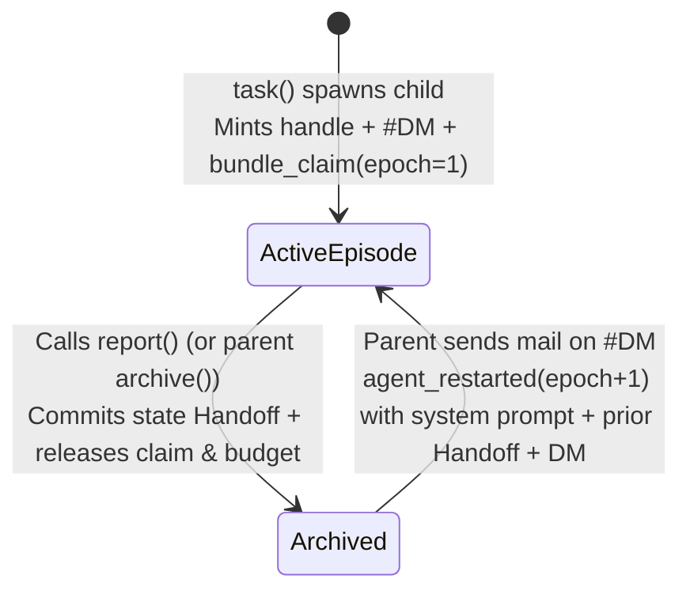

# Session Engine, Subagents & Channels

`crates/hya-engine` provides the single-agent `SessionEngine` and extension host on top of the `hya-core` kernel, while modular native ABI v2 bundles (`hya/multi-agent`, `hya/agent-channels`, `hya/goal`, `hya/loop`, and `hya/workflow`) layer multi-agent supervision, vertical channels, governed loops, and Workflow DAG execution solely through `Arc<dyn HostRuntime>` ([ADR-0039](../adr/0039-hya-bare-and-v2-modular-architecture.md)).

---

## 1. Turn Lifecycle & Immutable `TurnBinding`

When a prompt, slash command, or shell turn enters `SessionEngine`:

1. **Lease reservation:** Each session allows at most one active turn at a time (`TurnGate` / `TurnLease`). Concurrent requests receive `409 session_busy`.
2. **Immutable `TurnBinding`:** At turn start, the engine resolves the session's `CatalogScope` (`Global`, `Directory`, or `Project`) into an immutable snapshot of tools, skills, hooks, agent definitions, and guidance. If a user installs a bundle or reloads skills mid-turn, the running turn finishes cleanly on its captured binding while the *next* turn picks up the new generation.
3. **File snapshots & `/undo`:** Before mutating tools run, workspace file hashes/blobs are recorded (`FilesChanged` + `file_blob`). Calling `RevertSession` (`/undo`) hides the reverted messages in the projection and restores prior bytes on disk until `/redo` or the next user message commits the cut.

---

## 2. Episodic Resident Subagents (`hya/multi-agent`)

Since `0.41.0` ([ADR-0015](../adr/0015-unified-resident-subagent-lifecycle.md)), Hya has **one unified subagent model**: every child spawned via `task` (or a Workflow Stage) is an **episodic resident actor** (`MAX_SUBAGENT_DEPTH = 2`), packaged in `bundles/builtin/multi-agent` over Lockstep Native ABI v2.

### Key invariants

- **Deterministic handles:** Minted on the team-root log as `main/<type>-<operator>` (e.g. `main/hya-scout-suzuran`).
- **Transactional epoch fencing (`bundle_claim` / `ActorClaim`):** Every durable write by a subagent checks its fenced lease in SQLite's generic `bundle_claim` table (via `HostBundleStorage`). A stale or superseded worker can never commit late tool results or consume mail meant for its replacement.
- **Zero-cost sleep & Handoff revival:** On `report`, Hya checks that the subagent has no unread mail and no still-running children, summarizes its episode into a state-only **Handoff** (`model` summarizer or `deterministic` projection summary), refunds its concurrency/capacity lease, and archives it. Later downward mail on its `#DM` revives the same handle and session with `system prompt + handoff(n) + new DM` instead of replaying a huge stale transcript.
- **Concurrency & runaway budgets:** Bounds concurrent streaming members (`max_concurrency`), live team members (`per_run_budget`), total team turns (`per_team_turn_budget`), and total mail events (`per_team_message_budget`), configured in `~/.config/hya/bundles/hya%2Fmulti-agent/config.yml`.

---

## 3. Strictly Vertical Channel Plane (`hya/agent-channels`)

Inter-agent mail ([ADR-0016](../adr/0016-channel-communication-plane.md)) is event-sourced on the **team-root** session's `event_log` as `Event::Extension` (`bundle: "hya/agent-channels"`, kinds `channel_created`, `channel_joined`, `mail_sent`, `mail_consumed`) with **strictly vertical addressing**:

- **`#DM-{8}`:** Private 1-on-1 pipe between a parent and one direct child, persisted across archive/revive episodes.
- **`#announce-{8}`:** Broadcast pipe owned by a unit leader (`main` or a depth-1 parent) to all of its live direct children. Siblings cannot discover or message each other sideways.
- **Exactly-once cursor (`mail_consumed`):** Shared across in-turn `[NEW MAIL]` steering notices (`unread-mail-steer` `NativeHook`), mail-aware `wait` wakes, and `read channel://...` calls (`UriSchemaHandler`), preventing duplicate synthesis turns (`TEAM QUIESCED`) when a parent already read its children's reports during its turn.

---

## 4. Governed Execution (`hya/goal`, `hya/loop` & `hya/workflow`)

- **Goal (`hya -p`, `hya/goal`) & Loop (`hya loop`, `hya/loop`) drivers:** Implemented as ABI v2 `NativeDriver`s (`hya/goal:goal`, `hya/loop:loop`) in native bundles running over `HostRuntime` where stop authority belongs strictly to budgets, stall detection, `--until`/`--while` shell exit codes, and independent evaluator/verifier sessions or hooks.
- **Durable Workflow executor (`hya/workflow`):** Runs compiled `hya_workflow::CompiledWorkflow` Stage DAGs on top of `HostTurnRunner` and `Event::Extension` (`extensions["hya/workflow"]`)—mapping anonymous Stages to one-shot episodes, `actor:` keys to persistent resident sessions woken by mail, and `mode: loop` Stages to fresh verifier sessions, exposed via `BundleApi` (`/workflows`, `/state`, `/command`).
- **Sidecar wire contract:** Per-activation JavaScript sidecars and bundle processes speak newline-delimited JSON-RPC 2.0 using plugin protocol version 1 (`initialize` retains existing `protocol_version` and `host` fields, and the only activation-specific metadata is `{ activation_id, lifecycle }`).

---

## 5. Ordered Shutdown & Crash Recovery

`hya_app::BuiltSessionEngine::shutdown` and `hya_server::ServerRuntime::drain` tear down services in strict order so no SQLite writes or orphan child processes leak:

1. Fence new turn/Workflow admissions and close open SSE/gRPC streams with `serverStopping { reason }`.
2. Cancel in-flight root and subagent turns (5s `DRAIN_DEADLINE`), recording `pending_resume` rows on graceful server stops.
3. Join `ResidentSupervisor`, mailbox/lifecycle workers, and Workflow tasks.
4. Gracefully shut down (`shutdown` RPC) and reap all MCP and plugin child processes and their tracked I/O tasks.
5. Flush queued store writes (`EXIT_DRAIN_TIMEOUT` = 30s) and release `<db>.runtime-owner.lock`.
