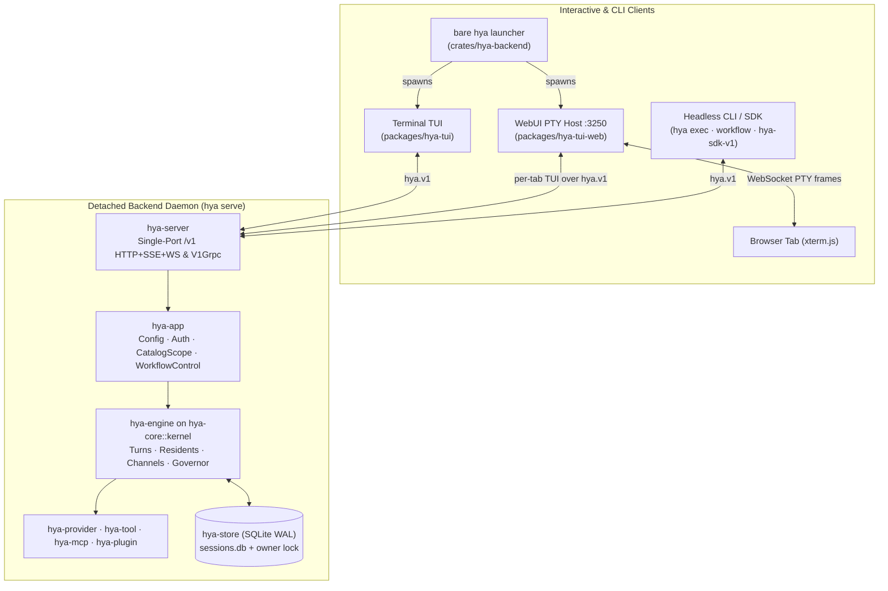

# Architecture Overview

Hya is a multi-agent coding runtime written in Rust, paired with a Bun/OpenTUI frontend. This page explains the big-picture design choices that hold the system together, so you can read any crate in the workspace without getting lost.

---

## Six core ideas behind Hya

### 1. One event log is the single source of truth

Every durable change in a conversation—your prompt, a model's completed reply, a tool call, a permission decision, token usage, inter-agent mail, or a Workflow step finishing—is appended as a typed `Event` to SQLite (`hya-store`).

Nothing maintains a separate "shadow state" table that can drift out of sync. Whenever the server, CLI, or SDK wants the current state of a session, it folds those events through one deterministic pure function: `hya_proto::Projection`.

- **Fast live tokens (`seq = 0`):** While a model is streaming words, tiny delta chunks fly over the in-memory bus with `seq = 0` so the UI feels instant without hammering SQLite on every token.
- **Durable checkpoints (`seq > 0`):** As soon as a text block, reasoning block, or tool call finishes, Hya writes it to SQLite in one atomic batch with monotonic sequence numbers (`seq > 0`).

### 2. A tiny three-primitive Kernel underneath Full Mode

At the bottom of the runtime sits `hya-core::kernel`—a minimal agent loop with just three context operations (**Model append**, **Tool append**, and **Rewrite**) and seven built-in kernel tools (`read`, `write`, `edit`, `bash`, `grep`, `todo`, `rewrite`). Passing the global `--bare` flag (`hya --bare`, `hya serve --bare`, `hya exec --bare`) runs the unified `SessionEngine` on top of that kernel with `BuiltinBundleProfile::Bare` (adding `skill`, built-in `code-mode` without `agent()`, `AGENTS.md`/MCP/plugin adapters, and the minimal `hya-bare` agent—while loading zero built-in bundles). Add `--pure` (`hya exec --bare --pure`) to also skip external `AGENTS.md`, disk skills, MCP, and plugins for pure kernel benchmarks.

Full mode (`hya-engine`) does **not** fork or replace that loop. Instead, it wraps the kernel with permissions, multi-root workspace checks, hooks, MCP servers, episodic subagents, Workflows, and gentler context-reduction steps (`hya/compaction`).

### 3. One background daemon per database, zero server `cwd`

- **Persistent single-writer daemon:** Each SQLite session database (`~/.local/state/hya/sessions.db`) has at most one writer at a time, guarded by an OS file lock (`<db>.runtime-owner.lock`) and advertised in `<db>.server.json`. Closing your terminal or browser leaves the daemon alive so reconnects are instant.
- **Client-chosen workspaces (`Project`):** The daemon itself has **no working directory**. Every session belongs either to a named **Project** (one or more folder roots on the host) or to an isolated scratch folder. One daemon can serve ten different repositories at the same time, lazily loading each Project's `.hya/bundles`, `.hya/plugins`, skills, and `AGENTS.md` on demand.

### 4. One contract (`hya.v1`) on one port, plus blind Relay encryption

`hya-server` exposes one Protobuf contract (`proto/hya/v1`: 18 services, 108 RPCs) over **both** `/v1` HTTP/JSON+SSE+WebSocket and gRPC on the **same TCP port**. Unary gRPC methods dispatch straight through the same internal router as HTTP, so HTTP and gRPC can never drift apart.

For remote access, `hya proxy` forwards encrypted byte streams between `hya serve --relay` and `hya bridge` / `hya --connect` using `Noise_NKpsk0`. The relay holds zero keys and sees only room IDs and ciphertext.

### 5. One UI codebase for both Terminal and Browser

Rendering never happens inside the Rust server. `packages/hya-tui` (TypeScript + OpenTUI on Bun) is the only interactive UI. To put that UI in a browser, `packages/hya-tui-web` spawns the exact same TUI on a real PTY and renders it with `xterm.js` over WebSocket—meaning terminal and browser never drift out of feature parity.

### 6. Sleeping subagents & engine-owned stop decisions

- **Episodic resident subagents:** Every helper spawned via `task` is an actor with its own session. When it calls `report`, the engine summarizes its state into a short *handoff*, releases its concurrency slot, and puts it to sleep (*archived*) at zero token cost. Sending follow-up mail down its `#DM` channel wakes the same helper into its next episode with that handoff.
- **Workers don't grade their own homework:** In Goal mode (`-p`), Loop mode (`hya loop`), and compiled Workflows (`*.hya.md`), the engine and separate verifier/evaluator sessions decide when an objective is finished—never the worker itself.

---

## Runtime process topology

---

## Where to dive deeper

- **[Repository & Crate Map](codebase-map.md)** — Directory layout, crate dependency graph, and which crate owns which change.
- **[Kernel & Context Engine](kernel-and-context.md)** — The $(m, g, w)$ context model, three primitives, `shake` / `remote` compaction, and `Rewrite`.
- **[Events & Storage](events-and-storage.md)** — Wire events, `Projection` folding, SQLite schema, single-writer locks, and degraded-store drain.
- **[Session Engine, Subagents & Channels](engine-and-subagents.md)** — Turn lifecycle, resident actor fencing, vertical `#DM`/`#announce` channels, and Workflows.
- **[Providers, Tool Plane & Scoping](providers-and-tools.md)** — Provider stream normalization, native tool ABI, `ProjectScope`, and lazy `CatalogScope`.
- **[Server, Relay & TUI Internals](server-relay-and-tui.md)** — Dual-protocol routing, `Noise_NKpsk0` relay internals, TUI state sync, and WebUI PTY host.
- **[Domain Glossary](glossary.md)** — Shared terminology across the codebase.
