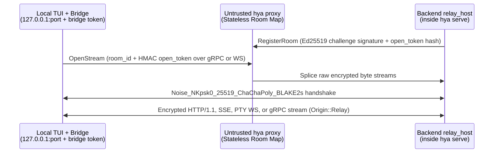

# Server, Relay & Frontend Internals

This page explains how `hya-server` serves HTTP and gRPC from one port, how `hya-relay` encrypts remote connections without trusting the proxy, and how `packages/hya-tui` and `packages/hya-tui-web` render the UI.

---

## 1. Single-Port Dual-Protocol Server (`crates/hya-server`)

`hya_server::build` constructs one Axum router backed by `AppState` that serves **both** HTTP (`/v2/*` JSON, SSE, WebSocket) and `tonic` gRPC (`V2Grpc`) on the same TCP listener:

- **Protocol dispatch:** Incoming requests with `content-type: application/grpc*` dispatch to `V2Grpc`; everything else routes to `/v2` HTTP handlers.
- **Zero drift by construction:** `cargo run -p xtask -- gen-api` generates `grpc_generated.rs` from `proto/hya/v2/*.proto` (`// hya.http:` annotations) so almost every unary gRPC method encodes its path/query/body and calls the exact same Axum handler in-process. Only streaming and loopback-only RPCs (`StreamSessionEvents`, `StreamGlobalEvents`, `StreamPty`, `Invoke*BundleApi`, `WaitTurn`, and `RelayControl`) have explicit adapters in `grpc.rs`.
- **Host allowlist guard (`host.rs`):** Rejects any HTTP `Host` or gRPC `:authority` outside `localhost`, `127.0.0.1`, `[::1]`, a specific `--bind` IP, or `--allow-host` names before CORS or route dispatch—blocking DNS-rebinding attacks from browsers.
- **Ephemeral session reaper (`ephemeral.rs`):** Speculatively created unused sessions (`ephemeral: true`) are automatically reaped ~5 seconds after their last `StreamSessionEvents` watcher disconnects (or 30 seconds on startup recovery) if no message, title, archive, or fork ever touched them.

---

## 2. Blind Zero-Trust Relay (`crates/hya-relay`)

`hya-relay` (`proto/hya/relay/v1`, [ADR-0025](../adr/0025-secure-relay.md)) has zero dependency on runtime crates and splits remote access into three roles:

1. **Identity & Link (`hya://host/room?t=auto#x25519_pub.psk`):** Derived from `<db>.relay-identity.json` (`0600`). `room_id` is `base32(sha256(ed25519_pub))[..26]`. Rotating the link (`hya serve relay rotate`) swaps `psk` and updates the proxy's open-token hash live, cutting off old links at the proxy before they even reach your machine.
2. **Stateless `hya proxy`:** Verifies Ed25519 room ownership and HMAC open tokens, enforces room/stream/bandwidth caps, and splices ciphertext bytes over either HTTP/2 gRPC or WebSocket (`t=auto` probes gRPC first and falls back to WebSocket behind proxies that strip trailers).
3. **Loopback `hya bridge` & `Origin::Relay`:** The client bridge requires a random 256-bit `x-hya-bridge-token` on every local TCP connection so arbitrary local processes or web pages cannot hijack the tunnel. On the backend, decrypted requests carry `Origin::Relay`, which blocks browser `Origin`/`Sec-Fetch-*` headers, `Process.DisposeProcess`/`UpgradeProcess`, and loopback-only `RelayControl` RPCs.

---

## 3. OpenTUI Frontend (`packages/hya-tui`)

`packages/hya-tui` (Solid + `@opentui/solid` on Bun) is Hya's sole interactive UI ([ADR-0019](../adr/0019-adopt-opentui-frontend.md), [ADR-0039](../adr/0039-hya-bare-and-v2-modular-architecture.md)):

- **Pure `hya.v2` transport:** Both `HyaClient` (HTTP/JSON+SSE under `/v2/*`) and `GrpcHyaClient` (`src/proto/hya/v2/*.proto`) speak exclusively `hya.v2`. Domain-specific endpoints (multi-agent roster/steer/archive, workflow listing/state/commands, channel inboxes) are never hardcoded in `packages/hya-tui`; bundles invoke their own endpoints through confined `BundleApi` calls.
- **Server projection is authoritative:** The TUI never builds a competing state model from raw SSE tokens. Live `seq = 0` deltas animate the active streaming block in `src/state/store.ts`, while durable boundaries (`messageFinished`, `sessionReverted`, `catalogUpdated`, `extensionEvent`, `resync`) reconcile directly against `/v2` server projections (`SessionInfo`, `SessionInfo.extensions`, messages).
- **Minimal core panes + dynamic bundle pane dispatch:** `src/state/panes.ts` and `src/components/paneRegistry.tsx` render only the five core panes (`conversation`, `composer`, `activity`, `status`, `layout`), delegate workspace slots (`projects`, `sessions`, `todos`, `context`, `jobs`) to `hya/basic-tui-components`, and dispatch all domain panes (`hya/multi-agent#subagents`, `hya/multi-agent#subagent-viewer`, `hya/workflow#workflows`, or third-party `<bundleId>#<paneId>`) generically via the `extension` pane kind.
- **v2-only layout persistence:** Saved `tui.json` `paneLayout` trees strictly require schema `version: 4` (n-ary containers with core/bundled/extension leaf kinds). Legacy v1→v2 `tui.json`/`tui.toml` migration lives exclusively in `crates/hya-migration`, never in `packages/hya-tui`.
- **Hot supervisor reload:** Bare `hya` launches `packages/hya-tui` under a tiny wrapper (`src/supervisor.ts`). After `hya serve restart` (or `/reload-tui`), the TUI restarts its own JS bundle in place while keeping your open session ID and unsent composer draft intact.
- **Confined TUI extensions:** Bundle `tui:` extensions (`api_version: 2`, `sdk: "2.0.0"`) run in a separate child process (`packages/hya-tui-sdk`) inside QuickJS WebAssembly VMs (64 MiB cap, 2s call deadline) or trusted JSC realms, wrapped in Linux Landlock + seccomp or macOS `sandbox_init`.
- **Zero-bundle bare startup (`hya --bare`):** When `GET /v2/tui-extensions` advertises an empty catalog, `ExtensionManager.settled()` resolves immediately without waiting for `hya/basic-tui-components`. `visiblePaneRoot` and `statusLineShown` gracefully collapse unavailable bundled sidebar panes (`projects`, `sessions`, `todos`, `context`, `jobs`, and `extension` panes) back to `chatPaneLayout()` (`conversation` + `activity` + `composer` + status line) with zero `"Loading…"` or missing-pane placeholders, while core overlays (`ProviderView`, `McpView`, `SkillsView`, `BundlesView`, `RulesView`, `DiffView`) remain operational.

---

## 4. Browser WebUI & PTY Host (`packages/hya-tui-web`)

`packages/hya-tui-web` ([ADR-0018](../adr/0018-browser-rendered-tui-test-environment.md), [ADR-0020](../adr/0020-bundle-tui-and-webui-in-hya.md)) is intentionally **generic**: it knows nothing about Hya's domain logic.

- For each browser tab on `http://127.0.0.1:3250`, it spawns `bun packages/hya-tui/src/main.ts ... --web-tab` on a real OS PTY (`Bun.spawn({ terminal })`) and exchanges `PtyClientFrame` / `PtyServerFrame` WebSocket messages with `xterm.js` in the browser.
- Standard terminal escape sequences drive browser features naturally: **OSC 0/2** sets `document.title`, **OSC 9/777** triggers deduplicated browser desktop `Notification`s when the tab is unfocused, **OSC 52** copies text to the clipboard, and dropped/pasted files upload to a `0700` temp directory and paste their quoted local paths into the PTY.
