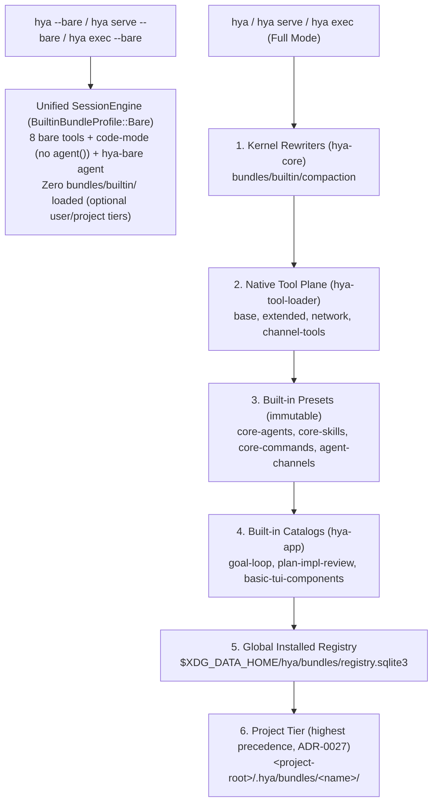

# `hyabundle` Specification

`hyabundle` (`.hyabundle` archive format) is Hya's unified, deterministic extension package format. Conceptually aligned with the Claude Code Plugin ecosystem, a single bundle can package any combination of:

- **Tools** — model-callable tools exposed through Hya's tool plane;
- **Hooks** — lifecycle interceptors and observers across Hya's 19 standard hook points;
- **MCP Servers** — bundle-local `stdio` MCP servers or external `http` / `sse` MCP endpoints;
- **Agents** — custom main or subagent roles with system prompts, model policies, and scoped resource views;
- **Skills & Commands** — on-demand `SKILL.md` guides and `/command` slash-command templates;
- **Advanced extensions** — compiled `*.hya.md` Workflows, vertical channel policies, custom URI `schemas:`, custom HTTP/gRPC `apis:`, custom `permission_modes:`, and sandboxed `@hya/tui-sdk` TUI panels.

For a quick authoring walkthrough, see **[Creating Bundles (`.hyabundle`)](bundles.md)**. For the architectural rationale behind this specification and the independent CI split, see **[ADR-0038](../adr/0038-hyabundle-standard-and-independent-ci.md)**.

---

## 1. Runtime Archetypes & Core Invariants

### 1.1 Three Bundle Archetypes

To replace the legacy split across four separate extension mechanisms (`extensions.js`, `extensions.process`, `extensions.rust`, `extensions.libraries`), `hyabundle` converges on **two executable runtimes** plus a **declarative static** form:

| Archetype | `runtime.kind` | Execution model | Primary use cases | Isolation & trust model |
| --- | --- | --- | --- | --- |
| **Static Bundle** | `static` *(default)* | No executable code; declarative manifests and assets only | Agents, Skills, Commands, Workflows, Channel policies, remote/local MCP config | Zero extra processes, zero native library overhead |
| **JS Bundle** | `js` | Out-of-process JS/TS interpreter (Bun) speaking **stdio NDJSON JSON-RPC 2.0 (Plugin Protocol v1)**; natively compatible with **Claude Code Plugins** | Ecosystem & user plugins: custom tools, hooks, model routers, HTTP APIs, permission modes, TUI extensions, imported Claude plugins | Separate OS subprocess; crashes or timeouts cannot destabilize the Hya host |
| **Native Bundle** | `native` | Pure Rust crate compiled to a dynamic library (`.so` / `.dylib` / `.dll`), loaded via `dlopen` against Hya's dynamic-linking ABI | High-performance built-in capabilities (`hya --bare` → full mode), kernel-level extensions (`Rewriter`), and future closed-source / commercial native extensions | In-process dynamic library; verified against SHA-256 ABI digest and trust boundary before loading |

### 1.2 Core Invariants

1. **Declaration separated from implementation:** Regardless of runtime (`js`, `native`, or `static`), every exported tool, hook, MCP server, agent, skill, and slash command is declared via standardized descriptor files. Hya can statically validate schemas, index catalogs, display permission postures, register MCP endpoints, and clamp agent tool views without spawning a process or loading a dynamic library.
2. **Minimal `hya --bare` bootability:** Built-in bundles under `bundles/builtin/` upgrade `BuiltinBundleProfile::Bare` into full mode, yet `hya --bare`, `hya serve --bare`, and `hya exec --bare` must always boot and run with the 8 standard bare tools (`read`, `write`, `edit`, `bash`, `grep`, `todo`, `rewrite`, `skill`) and zero dependency on `bundles/builtin/`.
3. **Packaged artifact separated from source tree:** Source directories may hold tests (`*.test.ts`), Rust source trees (`native/src/`), and READMEs. Packaging into `.hyabundle` includes only the declared closure and target runtime artifacts (JS entrypoints or compiled platform dynamic libraries), ensuring compact, deterministic, and optionally closed-source distribution.
4. **Portable, independent CI:** Bundle verification does not depend on Hya's main workspace test suite, `hya-e2e`, or TUI suites. External and community bundles (`bundles/extra/`, `bundles/examples/`, or future standalone Marketplace repositories) validate with zero Hya source-tree coupling.

---

## 2. Standard Repository Layout & Bundle Inventory

The repository organizes all bundles into **three top-level directories** (consolidating the legacy `presets/`, `first-party/`, and `internal/` groups into `bundles/builtin/`):

```text
bundles/
├── builtin/        # 13 trusted first-party bundles upgrading hya --bare to full mode
├── extra/          # 6 optional official extension bundles (Marketplace-ready)
└── examples/       # Developer starter & workflow examples
```

### 2.1 `bundles/builtin/` (13 Built-in Bundles)

All 13 bundles in `bundles/builtin/` ship in every release archive under `<prefix>/bundles/hya-<name>.hyabundle` and are verified by the independent `builtin-bundles` CI workflow. (`skill` and `code-mode` have been promoted into `hya-bare` core — `crates/hya-core/src/kernel/tools/skill.rs` and `packages/hya-code-mode/` + `crates/hya-app/src/code_mode.rs` — per [ADR-0039](../adr/0039-hya-bare-and-v2-modular-architecture.md).)

| Path | Legacy path | Bundle ID | Runtime | Capabilities | `bare` vs `full` loading role |
| --- | --- | --- | --- | --- | --- |
| `bundles/builtin/hashline` | *(extracted from `base-tools`)* | `hya/hashline` | **Native ABI v2** (`cdylib`) | 4 tools (`overrides: hya/bare`): `read`, `write`, `edit`, `grep` + `HashlineRuntime` | **Full default** via `hya-tool-loader` (`load_v2`); disable via `bundles.builtin.disable: [hya/hashline]` or `--bare` to fall back to `hya-bare` standard file tools |
| `bundles/builtin/base-tools` | `bundles/presets/base-tools` | `hya/base-tools` | **Native** (`cdylib`) | 6 tools: `ls`, `glob`, `find`, `ask_user`, `bash`, `apply_patch` | **Full required** via `hya-tool-loader`; skipped in `--bare` |
| `bundles/builtin/extended-tools` | `bundles/presets/extended-tools` | `hya/extended-tools` | **Native** (`cdylib`) | 9 tools: `lsp`, `list_agents`, `search_agent`, `task`, `archive`, `workflow`, `plan_exit`, `project_activity`, `wait` | **Full required** via `hya-tool-loader`; skipped in `--bare` |
| `bundles/builtin/network-tools` | `bundles/presets/network-tools` | `hya/network-tools` | **Native** (`cdylib`) | 2 tools: `webfetch`, `websearch` | **Full required** via `hya-tool-loader`; skipped in `--bare` |
| `bundles/builtin/channel-tools` | `bundles/presets/channel-tools` | `hya/channel-tools` | **Native** (`cdylib`) | 4 tools: `send`, `list_channel`, `wait`, `report` | **Full required** via `hya-tool-loader`; skipped in `--bare` |
| `bundles/builtin/compaction` | `bundles/internal/compaction` | `hya/compaction` | **Native** (`cdylib`) | 1 `Rewriter`: `shake` + `remote` context compaction | **Full required** via `hya_core::bundles::load_internal()`; skipped in `--bare` |
| `bundles/builtin/core-agents` | `bundles/presets/core-agents` | `hya/core-agents` | **Static** | 6 built-in agents (`hya-main`, `hya-plan`, `hya-task`, `hya-scout`, `hya-reviewer`, `hya-title`) + `policy.yaml` | **Full required** via `hya-engine::builtin_agents` |
| `bundles/builtin/core-skills` | `bundles/presets/core-skills` | `hya/core-skills` | **Static** | 2 built-in skills (`agent-bundle-authoring`, `secure-self-update`) | **Full required** via `hya-engine::skill_catalog` |
| `bundles/builtin/core-commands` | `bundles/presets/core-commands` | `hya/core-commands` | **Static** | 2 built-in slash commands (`/init`, `/review`) | **Full required** via `hya-server::support::command_catalog` |
| `bundles/builtin/agent-channels` | `bundles/presets/agent-channels` | `hya/agent-channels` | **Static** | 2 vertical channel policies (`unit-default`, `parent-dm-default`) | **Full required** via `hya-engine::channel_policy` |
| `bundles/builtin/goal-loop` | `bundles/first-party/goal-loop` | `hya/goal-loop` | **Static** | 5 skills + 2 private agents (`hya-goal-guide`, `hya-goal-verifier`) | **Full catalog** published by `hya-app::first_party_catalogs()` |
| `bundles/builtin/plan-impl-review` | `bundles/first-party/plan-impl-review` | `hya/plan-impl-review` | **Static** | 1 workflow (`plan-impl-review`) + 3 private stage agents (planner, implementer, reviewer) | **Full catalog** published by `hya-app::first_party_catalogs()` |
| `bundles/builtin/basic-tui-components` | `bundles/first-party/basic-tui-components` | `hya/basic-tui-components` | **JS / TUI** (`@hya/tui-sdk`) | Standard TUI panels (Projects, Sessions, Todos, Context) | **Full catalog** published by `hya-app::first_party_catalogs()`, loaded by `packages/hya-tui` |

### 2.2 `bundles/extra/` (6 Official Extra Bundles)

Optional bundles installed on demand (`hya bundle pack` + `hya bundle install`). Verified by the standalone `bundles` CI workflow and structured for future extraction into a dedicated Marketplace repository.

| Path | Bundle ID | Runtime | Capabilities | Self-check |
| --- | --- | --- | --- | --- |
| `bundles/extra/jev-model-router` | `hya-extra/jev-model-router` | **JS** (`process: bun`) | Hook: `chat.params` (difficulty-based dynamic model routing) | `router.test.ts` (`check: [bun, test]`) |
| `bundles/extra/model-fallback` | `hya-extra/model-fallback` | **JS** (`process: bun`) | Hook: `model.fallback` (per-model fallback chains) | `fallback.test.ts` (`check: [bun, test]`) |
| `bundles/extra/orchestrator` | `hya-extra/orchestrator` | **JS** (`process: bun`) | Tool: `workflow` + 4 agents (`orchestrator`, `orchestrator-scout`, `orchestrator-runner`, `orchestrator-editor`) | Static + protocol smoke |
| `bundles/extra/token-summary` | `hya-extra/token-summary` | **JS** (`process: bun`) | Tool: `token_summary` + Session API `GET /usage` + JSON Schema | `summary.test.ts` (`check: [bun, test]`) |
| `bundles/extra/scout` | `hya-extra/scout` | **Static + MCP** | MCP: `zvec-grep` (`stdio`) + Agent: `scout` | Static schema check |
| `bundles/extra/zvec-grep` | `hya-extra/zvec-grep` | **Static + MCP** | MCP: `zvec-grep` (`stdio`) + Skill: `zvec-grep` | Static schema check |

### 2.3 `bundles/examples/` (Developer Examples)

| Path | Bundle ID | Runtime | Purpose |
| --- | --- | --- | --- |
| `bundles/examples/argus-example` | `hya/argus-example` | **Static** | Multi-stage Workflow example with 10 subagents (also included in release archives as a runnable example). |

---

## 3. Source Directory Layout & Manifest Schema

### 3.1 Standard Source Directory Layout

All subdirectories are optional; include only the capabilities your bundle provides:

```text
<bundle-name>/
├── bundle.yaml                 # Required manifest (or bundle.hya.md for single-agent bundles; mutually exclusive)
├── README.md                   # Optional human documentation (not required in runtime closure)
├── config.example.yml          # Optional user config.yml template (never embed secrets)
├── tools/                      # Tool descriptor files (*.json / *.yaml)
│   └── <tool-id>.json
├── hooks/                      # Hook descriptor files (*.json / *.yaml)
│   └── hooks.json              # or split per hook: <hook-id>.json
├── mcp/                        # MCP server descriptor files (*.json)
│   └── <server-id>.json
├── agents/                     # Agent definitions (*.md frontmatter, or prompts/*.md)
│   └── <agent-id>.md
├── skills/                     # Skill guides (one directory per skill)
│   └── <skill-id>/SKILL.md
├── commands/                   # Slash command templates (*.md or commands.yaml)
│   └── <command-id>.md
├── workflows/                  # Workflow DAG definitions (fixed glob: workflows/*.hya.md)
│   └── <workflow-id>.hya.md
├── schemas/                    # JSON Schemas for custom HTTP/gRPC APIs
│   └── <schema>.json
├── tui/                        # TUI extension (@hya/tui-sdk)
│   └── main.ts
├── src/                        # [JS Bundle] TypeScript/JavaScript source & unit tests
│   ├── index.ts                # Entrypoint (pre-bundle to self-contained file if importing helpers)
│   └── index.test.ts           # Executed by check.command; excluded from .hyabundle archive
└── native/                     # [Native Bundle] Standalone Rust crate (crate-type = ["cdylib"])
    ├── Cargo.toml
    └── src/
        └── lib.rs
```

### 3.2 `bundle.yaml` Manifest Schema

Manifest parsing enforces strict unknown-field rejection (`deny_unknown_fields`) so typos fail immediately during validation or packaging.

```yaml
kind: Bundle
schema_version: 2               # 2 = standardized schema (1 remains supported for v1 transition)

identity:
  id: acme/my-bundle            # Required: <publisher>/<name>
  version: 1.0.0                # Required: SemVer (builtin bundles use 0.0.0 + version_ref: hya)
  publisher: acme               # Required: publisher identifier
version_ref: hya                # Optional: builtin bundles only; resolved to versions.toml at prepare time

namespace: my-bundle            # Optional: defaults to <name>; reserved: mcp, harness, builtin, plugin

# Unified runtime declaration: static (default) | js | native
runtime:
  kind: js                      # static | js | native
  # --- when kind: js ---
  mode: managed                 # managed (hya-plugin-bun) | process (standalone JSON-RPC) | claude
  entry: src/index.ts           # managed mode entrypoint (self-contained JS/TS)
  command: [bun, run, "${BUNDLE_ROOT}/src/index.ts"]  # process mode argv
  timeout_ms: 30000             # Optional: 1000..=3600000
  # --- when kind: native ---
  abi_version: 1                # 1 = lockstep ABI v1; 2 reserved for stable C-ABI
  crate_dir: native             # Source build directory (not packed as source files into .hyabundle)
  library: native/libacme_my_bundle.so  # Target dynamic library path inside packaged .hyabundle
  capabilities: [tools, hooks]  # Declared native capabilities: tools | hooks | rewriters

# Self-check contract executed by CI and `hya bundle verify`
# Tip: use `--pass-with-no-tests` with `bun test` so stripped `.hyabundle` archives (which omit `*.test.ts`) still verify cleanly.
check:
  command: [bun, test, --pass-with-no-tests]   # Direct argv (no shell interpolation)
  timeout_secs: 120                            # 1..=600

# Standardized resource descriptor index
resources:
  tools:
    - id: my_tool
      path: tools/my_tool.json
      aliases: [mt]             # Optional local aliases
  hooks:
    - id: tool.execute.before
      path: hooks/hooks.json
  mcp:
    - id: local-search
      path: mcp/local-search.json
  skills:
    - id: my-guide
      path: skills/my-guide/SKILL.md
  commands:                     # First-class slash command resources
    - id: review
      path: commands/review.md

# Agent definitions: standalone Markdown files (Claude Plugin compatible) or inline entries
agents:
  - path: agents/my-agent.md
  # Inline form also supported:
  # - id: my-agent
  #   role: subagent            # main | subagent
  #   description: ...
  #   prompt: prompts/my-agent.md
  #   model_policy: { category: quick, reasoning: low }
  #   resource_view: { allow: [...], deny: [...], aliases: {...} }
  #   advertise: [...]
  #   can_spawn: [...]
  #   private: false
  #   handoff: model            # model | deterministic
  #   hook_refs: [tool.execute.before]

# Advanced capabilities
workflow:
  id: my-flow
  path: workflows/my-flow.hya.md
channels: []                    # Vertical/unit communication channel policies
schemas: []                     # Custom URI schemes (e.g. db:// -> bundle tool)
apis: []                        # Custom HTTP/gRPC endpoints (requires runtime.kind: js process mode)
permission_modes: []            # Custom permission modes paired with hook/permission.approve
tui:                            # Sandboxed TUI extension (@hya/tui-sdk)
  api_version: 1
  entry: tui/main.ts
  sdk: "1.0"
  permissions: []

# Runtime data assets only (JSON schemas, templates, config skeletons).
# Native bundles do NOT list native/src/*.rs files here.
assets:
  - id: usage-schema
    path: schemas/usage.json
```

#### Transition Compatibility (`schema_version: 1`)

Existing manifests using `extensions: { js, process, rust, libraries, files }` remain supported during the v1 → v2 transition. Conflicting simultaneous declarations (for example declaring both top-level `runtime:` and legacy `extensions.process` or `extensions.libraries`) are rejected at parse time. Native bundles are no longer required to enumerate `native/src/*.rs` files under `extensions.files` or `assets:`.

---

## 4. Standardized Descriptor File Schemas

Both **JS Bundles** and **Native Bundles** use the exact same five descriptor schemas so static validation, catalog indexing, and permission inspection are identical across runtimes.

### 4.1 Tool Descriptor (`tools/<id>.json` or `tools/tools.yaml`)

```json
{
  "schema_version": 1,
  "name": "webfetch",
  "description": "Fetch a web page and extract readable content.",
  "permission": "tool",
  "aliases": [
    { "name": "fetch", "visibility": "hidden" }
  ],
  "prompt_hint": "fetch a web page",
  "protected": false,
  "parameters": {
    "type": "object",
    "properties": {
      "url": { "type": "string", "description": "Target HTTP(S) URL" }
    },
    "required": ["url"]
  },
  "entrypoint": {
    "js": "src/index.ts#webfetch",
    "native": "webfetch"
  }
}
```

- **`permission`**: `read_only` | `tool` | `command` | `interactive`.
- **`entrypoint`**:
  - JS (`managed`): `<module-path>#<exported-tool-name>`.
  - JS (`process`): tool name dispatched via JSON-RPC `tool/call`.
  - Native: matches `Tool::name()` registered by `hya_tool_bundle_register_v1`; mismatches fail bundle loading.
- **Namespacing**: Third-party and extra tools register under `<namespace>__<name>`. Trusted built-in tool families (`hya/*-tools`) register under canonical unprefixed names (`read`, `grep`, etc.); `rewrite` and `todo` remain reserved for `hya-core` ([ADR-0035](../adr/0035-full-mode-follows-the-kernel.md)).

### 4.2 Hook Descriptor (`hooks/hooks.json` or `hooks/<id>.json`)

Aligned with Claude Code's `hooks/hooks.json` semantics:

```json
{
  "schema_version": 1,
  "hooks": [
    {
      "event": "tool.execute.before",
      "matcher": "^bash$",
      "handler": {
        "kind": "js",
        "target": "src/index.ts#guardBash"
      },
      "failure_mode": "fail_closed",
      "timeout_ms": 5000
    },
    {
      "event": "model.fallback",
      "handler": {
        "kind": "rpc",
        "method": "hook/model.fallback"
      },
      "timeout_ms": 10000
    }
  ]
}
```

#### The 19 Standard Hook Events

| Category | Hook events |
| --- | --- |
| **Tools & Permissions (4)** | `tool.execute.before` *(always fail-closed)*, `tool.execute.after`, `permission.ask`, `permission.approve` |
| **Requests & Routing (4)** | `chat.params`, `model.fallback`, `message.user.before`, `command.execute.before` |
| **Text & Context (3)** | `experimental.text.complete`, `compaction.before`, `compaction.after` |
| **Goal & Loop Evaluators (4)** | `goal.evaluate`, `loop.verifier`, `loop.planner`, `loop.should_stop` |
| **Lifecycle Observation (4)** | `session.start`, `session.end`, `agent.spawn`, `event` |

#### `handler.kind` Targets

| `handler.kind` | Dispatch mechanism |
| --- | --- |
| `js` | Exported function loaded by `hya-plugin-bun` (`<path>#<export>`) |
| `rpc` | Standalone JSON-RPC 2.0 process method (`hook/<event>`) |
| `command` | Shell command hook executed by `hya-plugin-claude` (Claude Code compatibility) |
| `native` | Native dynamic-library hook handler (reserved symbol `hya_tool_bundle_register_hooks_v1`) |

### 4.3 MCP Server Descriptor (`mcp/<server-id>.json`)

Supports both bundle-local `stdio` servers and remote `http` / `sse` servers (compatible with `.mcp.json`):

```json
{
  "transport": "stdio",
  "command": ["bun", "run", "${BUNDLE_ROOT}/mcp/server.ts"],
  "env": {
    "CONFIG_PATH": "${BUNDLE_CONFIG_FILE}"
  },
  "timeout_ms": 600000,
  "enabled": true
}
```

```json
{
  "transport": "http",
  "url": "https://mcp.example.com/v1",
  "headers": {
    "Authorization": "Bearer ${env:EXAMPLE_API_TOKEN}"
  },
  "timeout_ms": 30000,
  "enabled": true
}
```

- **Validation rules:** Exactly one of `command` or `url` must be set (mutually exclusive). Path expansion only permits allowlisted placeholders (`${BUNDLE_ROOT}`, `${BUNDLE_CONFIG_FILE}`, `${BUNDLE_CONFIG_DIR}`) and `${env:VAR}` references; hardcoded secrets fail strict validation.
- **Tool plane naming:** Discovered MCP tools register as `mcp__<server_id>__<tool_name>` and pass through `ProjectScope` and permission approval.

### 4.4 Agent Descriptor (`agents/<agent-id>.md`)

Supports standalone Markdown files with YAML frontmatter (matching Claude Code Plugin `agents/*.md`) alongside inline `bundle.yaml#agents`:

```markdown
---
id: scout
role: subagent                  # main | subagent
description: Fast read-only retrieval scout.
color: cyan                     # Optional UI hint color
model_policy:
  category: quick               # Optional: quick | deep | ...
  reasoning: low                # Optional: low | medium | high
handoff: deterministic          # model (default) | deterministic
private: false                  # true = internal to workflows or explicit callers
can_spawn: []                   # Allowed child agent IDs
advertise: []                   # Optional subset of tools advertised to the model
hook_refs: []                   # Local hook IDs from this bundle only
resource_view:
  allow:
    - harness:tool/read
    - harness:tool/grep
    - harness:tool/glob
    - zvec-grep                 # Bundle-local resource ID
  deny: []
---
You are a read-only codebase scout. Return concise findings with `path:line` evidence.
```

### 4.5 Skill & Command Descriptors

- **Skill (`skills/<skill-id>/SKILL.md`):** YAML frontmatter (`name`, `description`) plus Markdown body; maximum 256 KiB per file.
- **Command (`commands/<command-id>.md`):** YAML frontmatter (`name`, `description`, `hints`, `subtask`) plus prompt template body supporting `$ARGUMENTS` expansion.

---

## 5. Runtime Wire & ABI Contracts

### 5.1 JS Bundle: stdio NDJSON JSON-RPC 2.0 (Plugin Protocol v1)

- **Framing:** One UTF-8 JSON object per line (max 1 MiB per frame). `stdin` and `stdout` carry protocol frames exclusively; diagnostic logs must write to `stderr`.
- **Environment injection:** The host injects `HYA_BUNDLE_ROOT` (materialized bundle directory), `HYA_BUNDLE_CONFIG_FILE` (user `config.yml`), and `HYA_BUNDLE_CONFIG_DIR`.
- **Host → Plugin methods:**
  - `initialize` *(5 s timeout)* — negotiates `protocol_version: 1`, receives plugin metadata, and verifies that declared `tools`, `hooks`, and `apis` match the manifest descriptors;
  - `shutdown` — requests clean process termination (exit `0`);
  - `event` — one-way notification;
  - `tool/call`, `api/request`, `hook/<event>` — request/response invocations.
- **Plugin → Host method:**
  - `host/capability` — authenticated with an invocation-scoped capability token; supports `context.describe`, `session.usage`, `workspace.state`, `permission.assert`, `tools.list`, and `tool.call`.

See **[Sidecar Plugins, Custom Tools & Hooks](plugins-and-hooks.md)** for full JSON-RPC payload examples.

#### Claude Code Plugin Compatibility Mapping (`hya-plugin-claude`)

`hya bundle install --claude <dir | marketplace#entry>` translates Claude Code plugins into deterministic `.hyabundle` packages:

| Claude Code Plugin artifact | `hyabundle` target |
| --- | --- |
| `plugin.json` / `.claude-plugin/plugin.json` | `identity.id: claude/<name>` |
| `agents/*.md` | `agents/` |
| `skills/*/SKILL.md` | `resources.skills` |
| `commands/*.md` | `resources.commands` |
| `.mcp.json` | `resources.mcp` |
| `hooks/hooks.json` | `PreToolUse` → `tool.execute.before`, `PostToolUse` → `tool.execute.after`, `PreCompact` → `compaction.before`, `SessionStart` → `session.start`, `SessionEnd` → `session.end`, `SubagentStart` → `agent.spawn` *(unsupported events fail import explicitly)* |

### 5.2 Native Bundle: Dynamic-Linking ABI

#### ABI v1 — Lockstep Rust ABI (Active for Built-in Native Bundles)

Implemented in `crates/hya-tool/src/native_bundle.rs` and verified by `crates/hya-tool-loader`:

| Exported C symbol | Required | Purpose |
| --- | --- | --- |
| `hya_tool_bundle_abi_v1(out: *mut u8)` | Yes | Writes a 32-byte SHA-256 ABI digest covering protocol version, Hya version, `rustc -V`, target OS/arch, core type layouts, and ABI source bytes. Any mismatch aborts load immediately. |
| `hya_tool_bundle_share_deadline_v1(cell: *const c_void)` | Yes | Shares host deadline and active task registry pointers. |
| `hya_tool_bundle_with_runtime_v1(handle, callback, state)` | Yes | Polls futures synchronously inside the bundle's Tokio runtime context. |
| `hya_tool_bundle_register_v1(out: *mut Vec<Arc<dyn Tool>>)` | Yes | Registers the bundle's `Tool` implementations. |
| `hya_tool_bundle_register_rewriters_v1(out: *mut Vec<Arc<dyn Rewriter>>)` | Optional | Registers `hya_context::rewrite::Rewriter` extensions (used by `hya/compaction`). |
| `hya_tool_bundle_register_hooks_v1(...)` | Reserved | Planned native hook registration symbol for parity with JS bundles. |

#### ABI v2 — Stable C-ABI (Roadmap for Third-Party Native Bundles)

Future third-party and closed-source native bundles will target `abi_version: 2`: a compiler-independent `extern "C"` boundary passing length-delimited JSON/Protobuf byte buffers with explicit host/plugin deallocation callbacks and version negotiation, removing the lockstep `rustc` coupling of ABI v1.

---

## 6. `.hyabundle` Archive Format & CLI Toolchain

### 6.1 Deterministic Archive Specification

- **Container:** Deterministic 7z archive (`PUBLIC_MAGIC = 0x37 0x7a 0xbc 0xaf 0x27 0x1c`), entries sorted lexicographically with normalized timestamps and permissions so identical inputs yield byte-for-byte identical SHA-256 digests.
- **Safety bounds:** Archive ≤ 128 MiB; uncompressed total ≤ 256 MiB; compression ratio ≤ 1000×; rejects symlinks, absolute paths, `..` traversal segments, special device nodes, and unreferenced/orphan files outside the manifest closure.
- **Artifact naming:**
  - Platform-independent bundles (Static / JS / TUI): `<publisher>-<name>-<version>.hyabundle` (installed built-ins use `hya-<name>.hyabundle`).
  - Platform-specific Native bundles: `<publisher>-<name>-<version>-<target-triple>.hyabundle` (installed built-ins use `hya-<name>.hyabundle`).

### 6.2 Packaging & Verification Commands

`hya bundle` provides self-contained packaging and validation commands so authors and external CI pipelines only need the `hya` binary (never `xtask` or the Hya Rust source tree):

```sh
# Package a bundle directory into a deterministic .hyabundle archive
hya bundle pack ./my-bundle ./my-bundle.hyabundle

# Validate a bundle directory or packaged .hyabundle archive
hya bundle verify --strict --protocol-smoke ./my-bundle
hya bundle verify --strict ./my-bundle.hyabundle

# Install globally or into the current project's .hya/bundles/
hya bundle install -y ./my-bundle.hyabundle
hya bundle install --project -y ./my-bundle.hyabundle
```

- **`hya bundle pack <source-dir> <output.hyabundle>`:** Validates the manifest and resource closure and writes a deterministic public `.hyabundle` archive.
- **`hya bundle verify [--strict] [--protocol-smoke] <package-or-dir>`:** Accepts either a source directory or a `.hyabundle` file. `--strict` enforces schema, descriptor, and secret-hygiene checks; `--protocol-smoke` spawns JS process bundles in an isolated temp copy, sends `initialize`, verifies declared `tools`/`hooks`/`apis` parity, and sends `shutdown`.

---

## 7. Loading, Resolution & Precedence Hierarchy

### 7.1 `hya --bare` vs Full Mode Resolution



- **Precedence (highest to lowest):** `Project Tier` (`<root>/.hya/bundles/`, ordered by registered Project roots, first root wins) → `Global Installed Registry` (`registry.sqlite3`) → `Built-in Catalog Tier`.
- **Immutability guard:** Reserved built-in identities (`hya/*` presets and reserved core agent IDs such as `hya-title`) cannot be uninstalled or shadowed by external bundles.

### 7.2 Physical Load Sources for `bundles/builtin/`

Hya selects the physical load source for the 13 built-in bundles automatically based on how `hya` is launched:

1. **Development checkout (Cargo build outside `<prefix>/bin/`):**
   - *Manifests & static assets:* Reads directly from `bundles/builtin/<name>/` (or `HYA_FIRST_PARTY_SOURCE_ROOT` when pinned by daemon rollback snapshots), falling back to `<target-dir>/bundles/hya-<name>.hyabundle`.
   - *Native dynamic libraries:* Searches `<exe-dir>/deps/libhya_<name>.*`, `<exe-dir>/libhya_<name>.*`, and Cargo per-unit `build/hya-<name>/*/out/libhya_<name>.*`, verifying the 32-byte ABI digest before falling back to `.hyabundle` extraction.
2. **Installed release prefix (`<prefix>/bin/hya`):**
   - *Strict allowlist:* Trusts only `<prefix>/bundles/hya-<name>.hyabundle`, ignoring source directories outside the prefix.
   - *Native extraction & cache:* Verifies archive SHA-256 and manifest integrity, extracts `native/libhya_<name>.*` to a read-only content-addressed cache (preserving stable inodes), verifies the 32-byte ABI digest, and loads via `dlopen(RTLD_NOW | RTLD_LOCAL)`.

### 7.3 Config Injection & Runtime Materialization

- **User configuration:**
  - Global installs: `~/.config/hya/bundles/<percent-encoded-id>/config.yml`
  - Project installs: `<root>/.hya/bundles/<dir>/config.yml`
- **Fingerprinting & hot refresh:** Hya injects `HYA_BUNDLE_CONFIG_FILE` and `HYA_BUNDLE_CONFIG_DIR` on launch and hashes config contents into the bundle's runtime fingerprint so `hya bundle refresh` restarts only affected bundle processes.
- **Materialization & cleanup:** Bundles with executable processes or local MCP servers materialize into `0o700` temporary directories; when a generation retires or the server shuts down, `BundleOwner::shutdown()` sends JSON-RPC `shutdown`, stops child MCP processes, and removes the temp directory.

---

## 8. Independent Bundle CI Architecture

Bundle CI is split out of Hya's core workspace workflow (`.github/workflows/ci.yml`) into **two dedicated workflows** backed by a zero-dependency portable runner under `scripts/bundle-ci/`:

```text
.github/workflows/
├── ci.yml                  # Core Hya CI (Rust crates, E2E, Frontend, TUI, Docs)
│                           #   -> bundles/extra/** and bundles/examples/** do NOT trigger core Rust/E2E/TUI
├── builtin-bundles.yml     # Workflow: builtin-bundles (bundles/builtin/**, required branch gate)
└── bundles.yml             # Workflow: bundles (bundles/extra/** & bundles/examples/**, Marketplace-portable)

scripts/bundle-ci/
├── discover.mjs            # Scans bundle roots, classifies native/js/tui/static, emits Actions matrix JSON
└── verify.mjs              # Zero-dependency verifier: static checks, check.command, JSON-RPC smoke, pack check
```

### 8.1 `builtin-bundles` Workflow (`.github/workflows/builtin-bundles.yml`)

Scoped strictly to `bundles/builtin/**` (plus bundle core/loader crates and workflow self-changes), running without `hya-e2e`, unrelated crates, or TUI suites:

1. **`discover`** — scans `bundles/builtin/*` and emits separate `native` (5 bundles) and `js_static` (8 bundles) matrices.
2. **`validate`** — runs `scripts/bundle-ci/verify.mjs` static schema and descriptor validation across all 13 built-in bundles.
3. **`test-native`** *(5-way matrix)* — runs per-crate `cargo clippy` and `cargo test`, compiles the `cdylib`, verifies required exported ABI v1 symbols (`hya_tool_bundle_abi_v1`, `hya_tool_bundle_register_v1`, `hya_tool_bundle_with_runtime_v1`, `hya_tool_bundle_share_deadline_v1`, plus `hya_tool_bundle_register_rewriters_v1` for `compaction`), and packs/verifies `.hyabundle`.
4. **`test-js-static`** *(8-way matrix)* — requires only Bun (no Rust build); executes `check.command` and black-box JSON-RPC protocol smoke tests via `scripts/bundle-ci/verify.mjs`, plus `.hyabundle` pack/verify.
5. **`bare-vs-full-smoke`** — confirms `hya exec --bare` runs without `bundles/builtin/` and that all 13 staged `.hyabundle` packages load cleanly.
6. **`builtin-bundles-gate`** — single summary status check for branch protection.

### 8.2 `bundles` Workflow (`.github/workflows/bundles.yml` — Marketplace-Portable)

Scoped to `bundles/extra/**` and `bundles/examples/**` (plus `scripts/bundle-ci/**`) with **zero dependency on Hya's Rust workspace tests**:

1. **`discover`** — finds changed (or all) bundles via `scripts/bundle-ci/discover.mjs` and outputs a per-bundle matrix.
2. **`verify-bundle`** *(per-bundle matrix)* — runs `scripts/bundle-ci/verify.mjs` (or `hya bundle verify --strict --protocol-smoke` + `hya bundle pack`):
   - **Static spec validation:** `bundle.yaml`, descriptor files, path safety, symlink rejection, and secret-leak checks;
   - **Self-check execution:** runs declared `check.command` within `timeout_secs`;
   - **Black-box JSON-RPC protocol smoke:** spawns JS process bundles in a temp directory with `HYA_BUNDLE_ROOT` and `HYA_BUNDLE_CONFIG_FILE`, sends `initialize`, asserts declared `tools`/`hooks`/`apis` parity, and sends `shutdown`;
   - **Deterministic pack round-trip:** when a `hya` binary is available, packs twice and asserts identical SHA-256 digests plus `hya bundle verify`.
3. **`bundles-gate`** — aggregates per-bundle results.

Because `bundles.yml` and `scripts/bundle-ci/` depend only on Bun and an optional release `hya` binary, moving `bundles/extra/` into an independent Marketplace repository requires copying the workflow and scripts with no Rust workspace glue.
