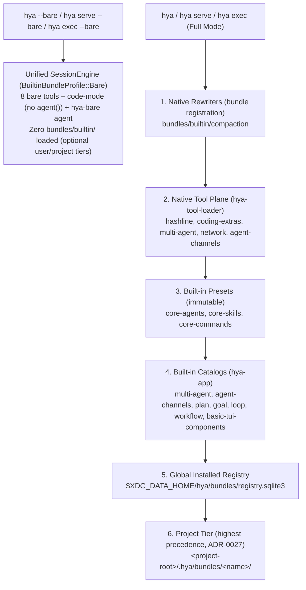

# `hyabundle` Specification

`hyabundle` (`.hyabundle` archive format) is Hya's unified, deterministic extension package format. Conceptually aligned with the Claude Code Plugin ecosystem, a single bundle can package any combination of:

- **Tools** — model-callable tools exposed through Hya's tool plane;
- **Hooks** — lifecycle interceptors and observers across Hya's 20 standard hook points;
- **MCP Servers** — bundle-local `stdio` MCP servers or external `http` / `sse` MCP endpoints;
- **Agents** — custom main or subagent roles with system prompts, model policies, and scoped resource views;
- **Skills & Commands** — on-demand `SKILL.md` guides and `/command` slash-command templates;
- **Advanced extensions** — compiled `*.hya.md` Workflows, vertical channel policies, custom URI `schemas:`, custom HTTP/gRPC `apis:`, custom `permission_modes:`, and sandboxed `@hya/tui-sdk` TUI panels.

For a quick authoring walkthrough, see **[Creating Bundles (`.hyabundle`)](bundles.md)**. For the native Rust `cdylib` contract, see **[Native Bundle Runtime ABI v2](native-abi.md)**. For the architectural rationale behind this specification and Hya v2's modular split, see **[ADR-0038](../adr/0038-hyabundle-standard-and-independent-ci.md)** and **[ADR-0039](../adr/0039-hya-bare-and-v2-modular-architecture.md)**.

---

## 1. Runtime Archetypes & Core Invariants

### 1.1 Three Bundle Archetypes

`hyabundle` (`schema_version: 2`) converges on **two executable runtimes** plus a **declarative static** form (and allows hybrid `native` + `tui` bundles that pair a Rust `cdylib` with a `@hya/tui-sdk` v2 UI extension):

| Archetype | `runtime.kind` | Execution model | Primary use cases | Isolation & trust model |
| --- | --- | --- | --- | --- |
| **Static Bundle** | `static` *(default)* | No executable code; declarative manifests and assets only | Agents, Skills, Commands, Workflows, Channel policies, remote/local MCP config, standalone TUI bundles | Zero extra processes, zero native library overhead |
| **JS Bundle** | `js` | Out-of-process JS/TS interpreter (Bun) speaking **stdio NDJSON JSON-RPC 2.0 (Plugin Protocol v1)**; natively compatible with **Claude Code Plugins** | Ecosystem & user plugins: custom tools, hooks, model routers, HTTP APIs, permission modes, TUI extensions, imported Claude plugins | Separate OS subprocess; crashes or timeouts cannot destabilize the Hya host |
| **Native Bundle** | `native` | Pure Rust crate compiled to a dynamic library (`.so` / `.dylib` / `.dll`), loaded via `dlopen` against Lockstep Native ABI v2 (`crates/hya-runtime-abi`) | High-performance built-in capabilities (`hya --bare` → full mode), kernel-level `Rewriter` extensions, managed services, drivers, and `BundleApi` handlers | In-process dynamic library; verified against 32-byte SHA-256 ABI v2 digest and mediated exclusively through `Arc<dyn HostRuntime>` |

### 1.2 Core Invariants

1. **Declaration separated from implementation:** Regardless of runtime (`js`, `native`, or `static`), every exported tool, hook, MCP server, agent, skill, and slash command is declared via standardized descriptor files. Hya can statically validate schemas, index catalogs, display permission postures, register MCP endpoints, and clamp agent tool views without spawning a process or loading a dynamic library.
2. **Minimal `hya --bare` bootability:** Built-in bundles under `bundles/builtin/` upgrade `BuiltinBundleProfile::Bare` into full mode, yet `hya --bare`, `hya serve --bare`, and `hya exec --bare` must always boot and run with the 8 standard bare tools (`read`, `write`, `edit`, `bash`, `grep`, `todo`, `rewrite`, `skill`) and zero dependency on `bundles/builtin/`.
3. **Packaged artifact separated from source tree:** Source directories may hold tests (`*.test.ts`), Rust source trees (`native/src/`), and READMEs. Packaging into `.hyabundle` includes only the declared closure and target runtime artifacts (JS entrypoints or compiled platform dynamic libraries), ensuring compact, deterministic, and optionally closed-source distribution.
4. **Portable, independent CI:** Bundle verification does not depend on Hya's main workspace test suite, `hya-e2e`, or TUI suites. External and community bundles (`bundles/extra/`, `bundles/examples/`, or future standalone Marketplace repositories) validate with zero Hya source-tree coupling.

---

## 2. Standard Repository Layout & Bundle Inventory

The repository organizes all bundles into **three top-level directories** (consolidating the legacy `presets/`, `first-party/`, and `internal/` groups into `bundles/builtin/`):

```text
bundles/
├── builtin/        # 15 trusted first-party bundles upgrading hya --bare to full mode
├── extra/          # 6 optional official extension bundles (Marketplace-ready)
└── examples/       # Developer starter & workflow examples
```

### 2.1 `bundles/builtin/` (15 Built-in Bundles)

All 15 bundles in `bundles/builtin/` (11 native ABI v2 bundles—4 of which are hybrid `native` + `tui` bundles—3 static preset bundles, and 1 standalone `@hya/tui-sdk` v2 bundle) ship in every release archive under `<prefix>/bundles/hya-<name>.hyabundle` and are verified by the independent `builtin-bundles` CI workflow. (`skill` and `code-mode` live inside `hya-bare` core — `crates/hya-core/src/kernel/tools/skill.rs` and `packages/hya-code-mode/` + `crates/hya-app/src/code_mode.rs` — per [ADR-0039](../adr/0039-hya-bare-and-v2-modular-architecture.md).)

| Path | Bundle ID | Runtime | Capabilities | `bare` vs `full` loading role |
| --- | --- | --- | --- | --- |
| `bundles/builtin/hashline` | `hya/hashline` | **Native ABI v2** (`cdylib`) | 4 tools (`overrides: hya/bare`): `read`, `write`, `edit`, `grep` + `HashlineRuntime` | **Full default** via `hya-tool-loader` (`load_v2`); disable via `bundles.builtin.disable: [hya/hashline]` or `--bare` to fall back to `hya-bare` standard file tools |
| `bundles/builtin/coding-extras` | `hya/coding-extras` | **Native ABI v2** (`cdylib`) | 7 tools (`ls`, `glob`, `find`, `apply_patch`, `ask_user`, `lsp`, `project_activity`), `lsp-formatter` `NativeService`, `tool.execute.after` + `tool.visibility` `NativeHook`s, and a `NativeBundleApiHandler` (`apis`: `GET /lsp/symbols`); the bundle owns its formatter and LSP state, the core has neither | **Full default** via `hya-tool-loader` (`load_v2`); disable via `bundles.builtin.disable: [hya/coding-extras]` or `--bare` |
| `bundles/builtin/multi-agent` | `hya/multi-agent` | **Native ABI v2** (`cdylib`) + **TUI v2** | 5 tools (`list_agents`, `search_agent`, `task`, `archive`, `wait`), 3 built-in subagents (`hya-task`, `hya-scout`, `hya-reviewer`), `MultiAgentService` (`services`) with `bundle_claim`/`bundle_state` leases, `session.end` lifecycle `NativeHook` (`hooks`), `ProjectionReducer` (`extensions["hya/multi-agent"]`), `NativeBundleApiHandler` (`apis`: `/members`, `/archive`, `/steer`), and `@hya/tui-sdk` v2 `subagents` / `subagent-viewer` panes + `/subagents` command | **Full catalog + native ABI v2 + TUI v2** via `hya-tool-loader` & `hya-app`; skipped in `--bare` |
| `bundles/builtin/network` | `hya/network` | **Native ABI v2** (`cdylib`) | 2 tools (`webfetch`, `websearch`) + `NetworkService` + `ToolVisibility` hook (`config.yml`) | **Full default** via `hya-tool-loader`; disableable for air-gapped operation & skipped in `--bare` |
| `bundles/builtin/agent-channels` | `hya/agent-channels` | **Native ABI v2** (`cdylib`) + static `channels:` + **TUI v2** | 4 tools (`send`, `list_channel`, `report`, and mail-aware `wait` with `overrides: hya/multi-agent`), `AgentChannelsService` (`services`), `channel://` `UriSchemaHandler` (`schemas`), `unread-mail-steer` `NativeHook` (`hooks`), read-only `BundleApi` (`apis`), `ProjectionReducer`, 2 default channel templates (`unit-default`, `parent-dm-default`), and `@hya/tui-sdk` v2 `send`/`list_channel`/`report` renderers + unread mail status badge | **Full default** via `hya-tool-loader` (`load_v2`); skipped in `--bare` |
| `bundles/builtin/compaction` | `hya/compaction` | **Native ABI v2** (`cdylib`) | 1 `Rewriter` (`shake` + `remote`, reads `keep_recent` from its own `config.yml`) + 1 `ProjectionReducer` (`extensions["hya/compaction"]`; eviction notices through `tool_output_overrides`) | Loaded through native bundle registration when enabled; disabled by the bare profile |
| `bundles/builtin/workspace-files` | `hya/workspace-files` | **Native ABI v2** (`cdylib`) | [Filesystem and Git worktree endpoints](../protocol/README.md#workspace-files-and-worktrees) over `BundleApi` | **Full catalog + native ABI v2**, skipped in `--bare` |
| `bundles/builtin/plan` | `hya/plan` | **Native ABI v2** (`cdylib`) + **TUI v2** | `hya-plan` read-only main agent, `plan_exit` tool (hidden alias `plan`), `tool.visibility` native hook, and `@hya/tui-sdk` v2 `plan_exit` card renderer + `Plan` status badge | **Full catalog + native ABI v2 + TUI v2** via `hya-tool-loader` & `hya-app`; skipped in `--bare` |
| `bundles/builtin/goal` | `hya/goal` | **Native ABI v2** (`cdylib`) | the `goal` driver (`drivers`, `hya/goal:goal`) + `GoalDriverService` (`services`), 3 goal skills (`goal-contract`, `guided-goal`, `evaluator-prompt`), and 2 private agents (`hya-goal-guide`, `hya-goal-verifier`) | **Full catalog + native ABI v2** via `hya-tool-loader` & `HostRuntime::goal_driver()`; skipped in `--bare` (`hya -p` errors cleanly when disabled) |
| `bundles/builtin/loop` | `hya/loop` | **Native ABI v2** (`cdylib`) | the `loop` driver (`hya/loop:loop`), `LoopService` (`capabilities: [services, drivers]`), and `loop-verifier-prompt` / `loop-planner-prompt` skills | **Full catalog + native ABI v2** via `hya-tool-loader` & `HostRuntime::loop_driver()`; skipped in `--bare` (`hya loop` errors cleanly when disabled) |
| `bundles/builtin/workflow` | `hya/workflow` | **Native ABI v2** (`cdylib`) + **TUI v2** | `workflow` tool, `WorkflowService` (`services`) DAG execution & durable replay, `ProjectionReducer` (`extensions["hya/workflow"]`), `NativeBundleApiHandler` (`apis`: `GET /workflows`, `GET /state`, `POST /command`), built-in default workflow (`workflows/plan-impl-review.hya.md`) + 3 private stage agents (`hya-pir-{planner,implementer,reviewer}`), and `@hya/tui-sdk` v2 `workflows` pane + `/workflow` slash commands | **Full catalog + native ABI v2 + TUI v2** via `hya-tool-loader` & `hya-app`; skipped in `--bare` (`hya workflow` errors cleanly when disabled) |
| `bundles/builtin/core-agents` | `hya/core-agents` | **Static** | 2 agents: `hya-main` (`default_agent`, `can_spawn: ["*"]`) and the private `hya-title` | **Full default** through the bundle catalog like any agent bundle; without it the default agent is the core's `hya-bare` |
| `bundles/builtin/core-skills` | `hya/core-skills` | **Static** | 2 built-in skills (`agent-bundle-authoring`, `secure-self-update`) | **Full required** via `hya-engine::skill_catalog` |
| `bundles/builtin/core-commands` | `hya/core-commands` | **Static** | 2 built-in slash commands (`/init`, `/review`) | **Full required** via `hya-server::support::command_catalog` |
| `bundles/builtin/basic-tui-components` | `hya/basic-tui-components` | **Static + TUI v2** (`@hya/tui-sdk`) | Standard TUI panels (Projects, Sessions, Todos, Context, Project View, Jobs) | **Full catalog** published by `hya-app::first_party_catalogs()`, loaded by `packages/hya-tui` |

### 2.2 `bundles/extra/` (6 Official Extra Bundles)

Optional bundles installed on demand (`hya bundle pack` + `hya bundle install`). Verified by the standalone `bundles` CI workflow and structured for future extraction into a dedicated Marketplace repository.

| Path | Bundle ID | Runtime | Capabilities | Self-check |
| --- | --- | --- | --- | --- |
| `bundles/extra/jev-model-router` | `hya-extra/jev-model-router` | **JS** (`process: bun`) | Hook: `chat.params` (difficulty-based dynamic model routing) | `router.test.ts` (`check: [bun, test]`) |
| `bundles/extra/model-fallback` | `hya-extra/model-fallback` | **JS** (`process: bun`) | Hook: `model.fallback` (per-model fallback chains) | `fallback.test.ts` (`check: [bun, test]`) |
| `bundles/extra/orchestrator` | `hya-extra/orchestrator` | **JS** (`process: bun`) | Tool: `workflow` + 4 agents (`orchestrator`, `orchestrator-scout`, `orchestrator-runner`, `orchestrator-editor`) | Static + protocol smoke |
| `bundles/extra/token-summary` | `hya-extra/token-summary` | **JS** (`process: bun`) | Tool: `token_summary` + Session API `GET /usage` + JSON Schema | `summary.test.ts` (`check: [bun, test]`) |
| `bundles/extra/scout` | `hya-extra/scout` | **Static + MCP** | MCP: `zvec-grep` (`stdio`) + Agent: `scout` | Static schema check |
| `bundles/extra/zvec-grep` | `hya-extra/zvec-grep` | **Static + MCP** | MCP: `zvec-grep` (`stdio`) + Skill: `zvec-grep` | Static schema check |

### 2.3 `bundles/examples/` (Developer Examples)

| Path | Bundle ID | Runtime | Purpose |
| --- | --- | --- | --- |
| `bundles/examples/argus-example` | `hya/argus-example` | **Static** | Multi-stage Workflow example with 10 subagents (also included in release archives as a runnable example). |

---

## 3. Source Directory Layout & Manifest Schema

### 3.1 Standard Source Directory Layout

All subdirectories are optional; include only the capabilities your bundle provides:

```text
<bundle-name>/
├── bundle.yaml                 # Required manifest (or bundle.hya.md for single-agent bundles; mutually exclusive)
├── README.md                   # Optional human documentation (not required in runtime closure)
├── config.example.yml          # Optional user config.yml template (never embed secrets)
├── tools/                      # Tool descriptor files (*.json / *.yaml)
│   └── <tool-id>.json
├── hooks/                      # Hook descriptor files (*.json / *.yaml)
│   └── hooks.json              # or split per hook: <hook-id>.json
├── mcp/                        # MCP server descriptor files (*.json)
│   └── <server-id>.json
├── agents/                     # Agent definitions (*.md frontmatter, or prompts/*.md)
│   └── <agent-id>.md
├── skills/                     # Skill guides (one directory per skill)
│   └── <skill-id>/SKILL.md
├── commands/                   # Slash command templates (*.md or commands.yaml)
│   └── <command-id>.md
├── workflows/                  # Workflow DAG definitions (fixed glob: workflows/*.hya.md)
│   └── <workflow-id>.hya.md
├── schemas/                    # JSON Schemas for custom HTTP/gRPC APIs
│   └── <schema>.json
├── tui/                        # TUI extension (@hya/tui-sdk)
│   └── main.ts
├── src/                        # [JS Bundle] TypeScript/JavaScript source & unit tests
│   ├── index.ts                # Entrypoint (pre-bundle to self-contained file if importing helpers)
│   └── index.test.ts           # Executed by check.command; excluded from .hyabundle archive
└── native/                     # [Native Bundle] Standalone Rust crate (crate-type = ["cdylib"])
    ├── Cargo.toml
    └── src/
        └── lib.rs
```

### 3.2 `bundle.yaml` Manifest Schema

Manifest parsing enforces strict unknown-field rejection (`deny_unknown_fields`) so typos fail immediately during validation or packaging.

```yaml
kind: Bundle
schema_version: 2               # Required: v2 only (migrate v1 manifests via `hya-migration run`)

identity:
  id: acme/my-bundle            # Required: <publisher>/<name>
  version: 1.0.0                # Required: SemVer (builtin bundles use 0.0.0 + version_ref: hya)
  publisher: acme               # Required: publisher identifier
version_ref: hya                # Optional: builtin bundles only; resolved to versions.toml at prepare time

namespace: my-bundle            # Optional: defaults to <name>; reserved: mcp, harness, builtin, plugin
overrides: hya/bare             # Optional: declare bundle-level override of another bundle (e.g. hya/bare)
requires: [hya/agent-channels]  # Optional: bundles that must be enabled with this one (see "Prerequisites and default agent")
default_agent: my-lead          # Optional: this bundle's `role: main` Agent that becomes the default primary agent

# Unified runtime declaration: static (default) | js | native
runtime:
  kind: js                      # static | js | native
  # --- when kind: js ---
  mode: managed                 # managed (hya-plugin-bun) | process (standalone JSON-RPC) | claude
  entry: src/index.ts           # managed mode entrypoint (self-contained JS/TS)
  command: [bun, run, "${BUNDLE_ROOT}/src/index.ts"]  # process mode argv
  timeout_ms: 30000             # Optional: 1000..=3600000
  # --- when kind: native ---
  abi_version: 2                # Required: 2 (Lockstep Native ABI v2 via crates/hya-runtime-abi)
  crate_dir: native             # Source build directory (not packed as source files into .hyabundle)
  library: native/libacme_my_bundle.so  # Target dynamic library path inside packaged .hyabundle
  capabilities: [tools, hooks, rewriters, services, apis, schemas, drivers, providers]

# Self-check contract executed by CI and `hya bundle verify`
# Tip: use `--pass-with-no-tests` with `bun test` so stripped `.hyabundle` archives (which omit `*.test.ts`) still verify cleanly.
check:
  command: [bun, test, --pass-with-no-tests]   # Direct argv (no shell interpolation)
  timeout_secs: 120                            # 1..=600

# Standardized resource descriptor index
resources:
  tools:
    - id: my_tool
      path: tools/my_tool.json
      aliases: [mt]             # Optional local aliases (never `todo` or `rewrite`)
      overrides: hya/bare       # Optional: per-tool override target (e.g. hya/bare or hya/multi-agent)
  hooks:
    - id: tool.execute.before
      path: hooks/hooks.json
  mcp:
    - id: local-search
      path: mcp/local-search.json
  skills:
    - id: my-guide
      path: skills/my-guide/SKILL.md
  commands:                     # First-class slash command resources
    - id: review
      path: commands/review.md

# Agent definitions: standalone Markdown files (Claude Plugin compatible) or inline entries
agents:
  - path: agents/my-agent.md
  # Inline form also supported:
  # - id: my-agent
  #   role: subagent            # main | subagent
  #   description: ...
  #   prompt: prompts/my-agent.md
  #   model_policy: { category: quick, reasoning: low }
  #   resource_view: { allow: [...], deny: [...], aliases: {...} }
  #   advertise: [...]
  #   can_spawn: [...]         # Agent ids, or ["*"] for every non-private agent
  #   private: false
  #   handoff: model            # model | deterministic
  #   hook_refs: [tool.execute.before]

# Advanced capabilities
workflow:
  id: my-flow
  path: workflows/my-flow.hya.md
channels: []                    # Vertical/unit communication channel policies
schemas: []                     # Custom URI schemes (e.g. db:// -> bundle tool, or native UriSchemaHandler)
apis: []                        # Custom HTTP/gRPC endpoints (JS process mode OR Native ABI v2 NativeBundleApiHandler)
permission_modes: []            # Custom permission modes paired with hook/permission.approve
cli: []                         # `hya` commands this bundle contributes (see "CLI commands" below)
tui:                            # Sandboxed TUI extension (@hya/tui-sdk v2; may be combined with runtime.kind: native)
  api_version: 2
  entry: tui/main.ts
  sdk: "2.0.0"
  permissions: []

# Runtime data assets only (JSON schemas, templates, TUI sources, config skeletons).
# Native bundles do NOT list native/src/*.rs files here.
assets:
  - id: usage-schema
    path: schemas/usage.json
```

#### Strict `schema_version: 2` Enforcement

Hya v2 accepts **`schema_version: 2` manifests exclusively** ([ADR-0039](../adr/0039-hya-bare-and-v2-modular-architecture.md)). Legacy v1 manifests (`extensions.*` blocks, omitted `schema_version`, or legacy exposure policy files) are rejected at parse time; run `hya-migration run` to upgrade existing v1 user or project bundles (see **[Migrating from Hya v1 to v2](../guide/migration-v1-to-v2.md)**). Native bundles are never required to list `native/src/*.rs` files under `assets:`.

#### CLI commands (`cli:`)

A bundle can add commands to the `hya` command line ([ADR-0040](../adr/0040-context-kernel-is-the-only-core.md)). When the bundle is enabled, `hya --help` lists them and `hya <name> …` runs them; when it is disabled (or with `--bare` for built-in bundles) they do not exist. Each command routes to one of the bundle's own extension points:

- `driver: <name>` runs the bundle's native driver `<bundle-id>:<name>` in a headless in-memory session. The driver receives the parsed arguments as `DriverRequest::args` and returns a `DriverReport` (`stdout`, `stderr`, `exit_code`), which `hya` prints and exits with. Only `runtime.kind: native` bundles have drivers.
- `api: <endpoint-id>` calls one of the bundle's BundleApi endpoints with the JSON body `{"args": {…}, "cwd": "<absolute working directory of the caller>"}`; the reply body must be `{"stdout": …, "stderr": …, "exit_code": …}`, which `hya` prints (stdout, then stderr) and exits with when `exit_code` is nonzero. A failure the bundle detects is such a reply (for example `stderr: "Error: <message>\n"`, `exit_code: 1`); a missing endpoint, a non-2xx status, or a body of another shape is reported by `hya` itself (`Error: …`, exit 1). A Session-scope endpoint runs for a new session in the caller's directory; a Global endpoint gets no session. This works for JS (`apis:`) and native (`NativeBundleApiHandler`) bundles alike.

By default an `api` route runs on a headless in-memory store. With `database: true` it runs against `--db` instead, under the same database lock as `hya exec` (see [CLI reference: Database lock & exit codes](../reference/cli.md#database-lock--exit-codes)):

- When no live server holds the database, `hya` claims it, runs the call in process, and drains the store on exit. A command with a `value: session` argument given claims strictly; without one, an open timeout or storage fault falls back to an in-memory store, as `hya exec` does.
- When a server owns the database, the call goes to it over `/v2` (`/v2/sessions/{session}/bundles/{bundle}/…` or `/v2/bundles/{bundle}/api/…`) with no client request timeout, so a long call is not cut off; permission asks and questions of the call's session tree are rejected while it runs. A Session-scope endpoint without a session argument gets a new session on the server (with `--model`/`--effort`).
- A `value: session` argument names an existing Session: a Session-scope endpoint runs for it instead of a new one (``Error: <command> Session `<id>` was not found`` when it does not exist). It stays in `args` as the typed string.
- `routed_refuse` lists what the owning server cannot take, in order. When the call would be routed and an entry's `arg` is given (a flag set, a string or integer present, a list non-empty) or its global `flag` (`bare`, `pure`, `yolo`) is set, `hya` prints ``hya <command>: database <db> is in use by hya server pid <pid> at <url>, and <reason>; stop it (`hya serve stop --db <db>`) or pass another --db`` and exits 75 before creating any session. In process the entries do not apply.

With `database: read` the route only reads `--db`: `hya` never claims it or goes through its server, so the command works while either holds it. When `--db` names an existing file, `hya` opens it read-only to find the Project of the working directory; the call then runs in process on an in-memory store holding that Project (or, without one, a Project of the working directory alone), on the offline provider with no `config.yaml` providers, MCP servers, or plugins and no `.hya/plugins` project plugins, and writes no config file. A Global endpoint sees the Project's roots through `resolve_scope_catalog(None, Some(cwd))`, whose `diagnostics` list the installed bundles that could not be read (`installed bundle <id>: <error>`) and the project bundles that failed to load (`project bundle <dir>: <error>`). `hya workflow list|info` (`hya/workflow`) prints them as `warning:` lines.

```yaml
cli:
  - name: notes
    subcommands:
      - name: show
        api: show               # a Session-scope endpoint
        database: true
        args:
          - { id: session, long: session, value: session }
          - { id: revision, long: revision }
        routed_refuse:
          - { arg: revision, reason: "`notes show --revision` cannot be sent to it" }
          - { flag: yolo, reason: "--yolo cannot apply to it" }
```

`kind: prompt` instead claims `hya -p/--prompt <PROMPT>` and adds its arguments as top-level flags; the driver receives the prompt as `args.prompt`. At most one enabled bundle may claim `-p`; without one, `hya -p` runs one headless turn.

```yaml
cli:
  - name: echo                  # hya echo …   ([a-z][a-z0-9-]*, not a core command)
    about: Print text through the bundle's driver.
    driver: echo                # or `api: <endpoint-id>`
    args:
      - id: text                # key in the JSON arguments
        long: text              # --text; omit long/short for a positional argument
        required: true
        help: Text to print.
      - id: times
        long: times
        value: integer          # string (default) | integer | flag | list
        default: "1"
      - { id: loud, long: loud, value: flag, conflicts_with: [quiet] }
      - { id: quiet, long: quiet, value: flag }
      - { id: tag, long: tag, value: list, aliases: [label], value_name: TAG }
  - name: group                 # a command with subcommands has no route itself
    subcommands:
      - { name: list, api: list }
  - kind: prompt                # claims `hya -p`
    driver: goal
    args:
      - { id: max_iterations, long: max-iterations, value: integer, default: "6" }
```

| Field | Type | Meaning |
| --- | --- | --- |
| `kind` | `command` (default) \| `prompt` | Adds `hya <name>`, or claims `hya -p`. |
| `name` | string | Subcommand name (`kind: command` only). |
| `about` | string | Help text. |
| `driver` / `api` | string | The route of a leaf command (exactly one). |
| `database` | `false` (default) \| `true` \| `read` | `true`: run the `api` route against `--db` (in process or through the owning server) instead of an in-memory store; `read`: read `--db` without claiming it (see above). |
| `routed_refuse[]` | list | `database: true` only: `{arg: <argument id>, reason}` or `{flag: bare\|pure\|yolo, reason}`; the first set entry exits 75 when the call would be routed. |
| `args[]` | list | `id`, `long`, `short`, `value` (`string`, `integer`, `flag`, `list`, `session`), `required`, `default`, `help`, `value_name`, `aliases`, `conflicts_with` (argument ids). Missing optional values are `null` in the JSON arguments; a flag is `true`/`false`; a list is an array; a `session` is the typed Session id string (at most one, `database: true` only). |
| `subcommands[]` | list | Nested commands with the same shape (no `kind: prompt`). |

Preparation rejects an invalid name, a leaf without exactly one route, a `driver` route on a non-native bundle, an `api` route to an undeclared endpoint of a JS bundle, duplicate names or flags, `conflicts_with` naming an unknown argument, `database` on a driver route or on `kind: prompt`, `value: session` or `routed_refuse` without `database: true`, more than one `value: session` argument, and a `routed_refuse` entry without exactly one known `arg` or `flag` and a `reason`. At startup `hya` rejects a command that shadows a core command or that two enabled bundles both contribute.

A user-installed native bundle (`runtime.library`) contributes commands the same way, and keeps them under `--bare`; [`bundles/examples/cli-driver-example`](../../bundles/examples/cli-driver-example) routes one command to a driver, one to a native Global BundleApi endpoint, and two `database: true` commands to a Global and a Session-scope endpoint.

#### Prerequisites and default agent (`requires:`, `default_agent:`, `can_spawn: ["*"]`)

A bundle names the bundles it cannot work without in `requires:`, and may make one of its Agents the default primary agent with `default_agent:` ([ADR-0040](../adr/0040-context-kernel-is-the-only-core.md) §5: bare to full is composition).

```yaml
requires: [hya/agent-channels]  # bundle ids (<publisher>/<name>)
default_agent: my-lead
agents:
  - id: my-lead
    role: main
    can_spawn: ["*"]            # may spawn every non-private agent of the catalog
```

| Field | Type | Meaning |
| --- | --- | --- |
| `requires` | list of `<publisher>/<name>` | Bundles that must be enabled with this one. A requirement is met by a bundle with that id or by a bundle that `overrides` it. Preparation sorts the list and removes duplicates. |
| `default_agent` | Agent id | This bundle's Agent that becomes the default primary agent while the bundle is enabled. |
| `agents[].can_spawn` | list of Agent ids, or `["*"]` | `"*"` grants spawning every non-private agent in the catalog, including agents installed later. |

Preparation rejects a `requires` entry that is not a `<publisher>/<name>` id or names the bundle itself; a `default_agent` that does not name a non-private `role: main` Agent of the same bundle; `"*"` combined with other `can_spawn` entries; and `"*"` in a bundle with a `workflow:` (a Workflow's Agent closure needs explicit ids). When the enabled set misses a prerequisite, a built-in bundle fails startup with a message naming the missing bundle, and an installed or project bundle is left out with a warning; nothing is enabled implicitly. At most one enabled bundle may declare `default_agent`; with none, the core's `hya-bare` agent is the default.

Prepared bundles carry both fields only when they are declared, so the digest of a bundle that uses neither does not change.

---

## 4. Standardized Descriptor File Schemas

Both **JS Bundles** and **Native Bundles** use the exact same five descriptor schemas so static validation, catalog indexing, and permission inspection are identical across runtimes.

### 4.1 Tool Descriptor (`tools/<id>.json` or `tools/tools.yaml`)

```json
{
  "schema_version": 1,
  "name": "webfetch",
  "description": "Fetch a web page and extract readable content.",
  "permission": "tool",
  "aliases": [
    { "name": "fetch", "visibility": "hidden" }
  ],
  "prompt_hint": "fetch a web page",
  "protected": false,
  "parameters": {
    "type": "object",
    "properties": {
      "url": { "type": "string", "description": "Target HTTP(S) URL" }
    },
    "required": ["url"]
  },
  "entrypoint": {
    "js": "src/index.ts#webfetch",
    "native": "webfetch"
  }
}
```

- **`permission`**: `read_only` | `tool` | `command` | `interactive`.
- **`entrypoint`**:
  - JS (`managed`): `<module-path>#<exported-tool-name>`.
  - JS (`process`): tool name dispatched via JSON-RPC `tool/call`.
  - Native: matches `Tool::name()` registered into `NativeRegistrations::tools` by `hya_native_register_v2`; mismatches fail bundle loading.
- **Namespacing & overrides:** Third-party and extra tools register under `<namespace>__<name>`. Trusted built-in bundles (`hya/*`) register under canonical unprefixed names (`read`, `grep`, etc.) and use explicit `overrides:` (such as `overrides: hya/bare` on `hya/hashline` or `overrides: hya/multi-agent` on `hya/agent-channels`'s `wait`). `rewrite` and `todo` remain permanently reserved for `hya-core` ([ADR-0035](../adr/0035-full-mode-follows-the-kernel.md), [ADR-0039](../adr/0039-hya-bare-and-v2-modular-architecture.md)).

### 4.2 Hook Descriptor (`hooks/hooks.json` or `hooks/<id>.json`)

Aligned with Claude Code's `hooks/hooks.json` semantics:

```json
{
  "schema_version": 1,
  "hooks": [
    {
      "event": "tool.execute.before",
      "matcher": "^bash$",
      "handler": {
        "kind": "js",
        "target": "src/index.ts#guardBash"
      },
      "failure_mode": "fail_closed",
      "timeout_ms": 5000
    },
    {
      "event": "model.fallback",
      "handler": {
        "kind": "rpc",
        "method": "hook/model.fallback"
      },
      "timeout_ms": 10000
    }
  ]
}
```

#### The 16 Core Hook Events

| Category | Hook events |
| --- | --- |
| **Tools & Permissions (5)** | `tool.execute.before` *(always fail-closed)*, `tool.execute.after`, `tool.visibility`, `permission.ask`, `permission.approve` |
| **Requests & Routing (4)** | `chat.params`, `model.fallback`, `message.user.before`, `command.execute.before` |
| **Text & Context (3)** | `experimental.text.complete`, `compaction.before`, `compaction.after` |
| **Lifecycle Observation (4)** | `session.start`, `session.end`, `agent.spawn`, `event` |

A hook may also implement a **bundle-declared hook point**, named
`<bundle-id>:<point>` (for example `hya/goal:evaluate` or `hya/loop:verifier`).
The declaring bundle registers the local point name in
`NativeRegistrations::hook_points`, owns the JSON payload shapes, and
dispatches the point through `HostExtensionRegistry::invoke_hook`. The first
implementer that answers wins (`null` defers), and a failing implementer is
skipped. A JSON-RPC process registers the full name in `hooks:` and receives
`hook/<bundle-id>:<point>`.

#### `handler.kind` Targets

| `handler.kind` | Dispatch mechanism |
| --- | --- |
| `js` | Exported function loaded by `hya-plugin-bun` (`<path>#<export>`) |
| `rpc` | Standalone JSON-RPC 2.0 process method (`hook/<event>`) |
| `command` | Shell command hook executed by `hya-plugin-claude` (Claude Code compatibility) |
| `native` | Native dynamic-library hook handler registered via ABI v2 (`hya_native_register_v2` / `NativeRegistrations::hooks`) |

### 4.3 MCP Server Descriptor (`mcp/<server-id>.json`)

Supports both bundle-local `stdio` servers and remote `http` / `sse` servers (compatible with `.mcp.json`):

```json
{
  "transport": "stdio",
  "command": ["bun", "run", "${BUNDLE_ROOT}/mcp/server.ts"],
  "env": {
    "CONFIG_PATH": "${BUNDLE_CONFIG_FILE}"
  },
  "timeout_ms": 600000,
  "enabled": true
}
```

```json
{
  "transport": "http",
  "url": "https://mcp.example.com/v1",
  "headers": {
    "Authorization": "Bearer ${env:EXAMPLE_API_TOKEN}"
  },
  "timeout_ms": 30000,
  "enabled": true
}
```

- **Validation rules:** Exactly one of `command` or `url` must be set (mutually exclusive). Path expansion only permits allowlisted placeholders (`${BUNDLE_ROOT}`, `${BUNDLE_CONFIG_FILE}`, `${BUNDLE_CONFIG_DIR}`) and `${env:VAR}` references; hardcoded secrets fail strict validation.
- **Tool plane naming:** Discovered MCP tools register as `mcp__<server_id>__<tool_name>` and pass through `ProjectScope` and permission approval.

### 4.4 Agent Descriptor (`agents/<agent-id>.md`)

Supports standalone Markdown files with YAML frontmatter (matching Claude Code Plugin `agents/*.md`) alongside inline `bundle.yaml#agents`:

```markdown
---
id: scout
role: subagent                  # main | subagent
description: Fast read-only retrieval scout.
color: cyan                     # Optional UI hint color
model_policy:
  category: quick               # Optional: quick | deep | ...
  reasoning: low                # Optional: low | medium | high
handoff: deterministic          # model (default) | deterministic
private: false                  # true = internal to workflows or explicit callers
can_spawn: []                   # Allowed child agent IDs, or ["*"] for every non-private agent
advertise: []                   # Optional subset of tools advertised to the model
hook_refs: []                   # Local hook IDs from this bundle only
resource_view:
  allow:
    - harness:tool/read
    - harness:tool/grep
    - harness:tool/glob
    - zvec-grep                 # Bundle-local resource ID
  deny: []
---
You are a read-only codebase scout. Return concise findings with `path:line` evidence.
```

### 4.5 Skill & Command Descriptors

- **Skill (`skills/<skill-id>/SKILL.md`):** YAML frontmatter (`name`, `description`) plus Markdown body; maximum 256 KiB per file.
- **Command (`commands/<command-id>.md`):** YAML frontmatter (`name`, `description`, `hints`, `subtask`) plus prompt template body supporting `$ARGUMENTS` expansion.

---

## 5. Runtime Wire & ABI Contracts

### 5.1 JS Bundle: stdio NDJSON JSON-RPC 2.0 (Plugin Protocol v1)

- **Framing:** One UTF-8 JSON object per line (max 1 MiB per frame). `stdin` and `stdout` carry protocol frames exclusively; diagnostic logs must write to `stderr`.
- **Environment injection:** The host injects `HYA_BUNDLE_ROOT` (materialized bundle directory), `HYA_BUNDLE_CONFIG_FILE` (user `config.yml`), and `HYA_BUNDLE_CONFIG_DIR`.
- **Host → Plugin methods:**
  - `initialize` *(5 s timeout)* — negotiates `protocol_version: 1`, receives plugin metadata, and verifies that declared `tools`, `hooks`, and `apis` match the manifest descriptors;
  - `shutdown` — requests clean process termination (exit `0`);
  - `event` — one-way notification;
  - `tool/call`, `api/request`, `hook/<event>` — request/response invocations.
- **Plugin → Host method:**
  - `host/capability` — authenticated with an invocation-scoped capability token; supports `context.describe`, `session.usage`, `workspace.state`, `permission.assert`, `tools.list`, and `tool.call`.

See **[Sidecar Plugins, Custom Tools & Hooks](plugins-and-hooks.md)** for full JSON-RPC payload examples.

#### Claude Code Plugin Compatibility Mapping (`hya-plugin-claude`)

`hya bundle install --claude <dir | marketplace#entry>` translates Claude Code plugins into deterministic `.hyabundle` packages:

| Claude Code Plugin artifact | `hyabundle` target |
| --- | --- |
| `plugin.json` / `.claude-plugin/plugin.json` | `identity.id: claude/<name>` |
| `agents/*.md` | `agents/` |
| `skills/*/SKILL.md` | `resources.skills` |
| `commands/*.md` | `resources.commands` |
| `.mcp.json` | `resources.mcp` |
| `hooks/hooks.json` | `PreToolUse` → `tool.execute.before`, `PostToolUse` → `tool.execute.after`, `PreCompact` → `compaction.before`, `SessionStart` → `session.start`, `SessionEnd` → `session.end`, `SubagentStart` → `agent.spawn` *(unsupported events fail import explicitly)* |

### 5.2 Native Bundle: Lockstep Native ABI v2 (`crates/hya-runtime-abi`)

All 10 first-party native bundles under `bundles/builtin/` target **Lockstep Native ABI v2** (`runtime.abi_version: 2`), implemented in `crates/hya-runtime-abi` (exported via `export_native_bundle_v2!`) and loaded by `crates/hya-tool-loader` (`load_v2`, `NativeBundleLoader`) per [ADR-0039](../adr/0039-hya-bare-and-v2-modular-architecture.md). Native ABI v2 crates MUST NOT link `hya-store`, `sqlx`, `hya-engine`, `hya-server`, `axum`, or `tonic`; instead, the host injects an `Arc<dyn HostRuntime>` into `NativePluginContext`.

| Exported C symbol | Required | Purpose |
| --- | --- | --- |
| `hya_native_abi_v2(out: *mut u8)` | Yes | Writes a 32-byte SHA-256 ABI v2 digest verified before registration. Mismatches fail cleanly with `AbiError::DigestMismatch`. |
| `hya_native_with_runtime_v2(handle, callback, state)` | Yes | Polls async futures synchronously inside the bundle's Tokio runtime context. |
| `hya_native_share_deadline_v2(cell: *const c_void)` | Yes | Shares the host's process-lifetime deadline cell with the dynamic library. |
| `hya_native_register_v2(ctx, regs, error_out) -> i32` | Yes | Populates `NativeRegistrations` (`tools`, `rewriters`, `services`, `hooks`, `api_handlers`, `projection_reducers`, `uri_schema_handlers`, `goal_drivers`, `loop_drivers`) via `export_native_bundle_v2!`. |

For the full `HostRuntime` sub-trait reference, `ExtensionPlanes`/`ErasedPlane` internals, and a complete worked Rust example, see **[Native Bundle Runtime ABI v2](native-abi.md)**. Future third-party and closed-source native bundles may later target a compiler-independent C-ABI boundary removing lockstep `rustc` coupling.

---

## 6. `.hyabundle` Archive Format & CLI Toolchain

### 6.1 Deterministic Archive Specification

- **Container:** Deterministic 7z archive (`PUBLIC_MAGIC = 0x37 0x7a 0xbc 0xaf 0x27 0x1c`), entries sorted lexicographically with normalized timestamps and permissions so identical inputs yield byte-for-byte identical SHA-256 digests.
- **Safety bounds:** Archive ≤ 128 MiB; uncompressed total ≤ 256 MiB; compression ratio ≤ 1000×; rejects symlinks, absolute paths, `..` traversal segments, special device nodes, and unreferenced/orphan files outside the manifest closure.
- **Artifact naming:**
  - Platform-independent bundles (Static / JS / TUI): `<publisher>-<name>-<version>.hyabundle` (installed built-ins use `hya-<name>.hyabundle`).
  - Platform-specific Native bundles: `<publisher>-<name>-<version>-<target-triple>.hyabundle` (installed built-ins use `hya-<name>.hyabundle`).

### 6.2 Packaging & Verification Commands

`hya bundle` provides self-contained packaging and validation commands so authors and external CI pipelines only need the `hya` binary (never `xtask` or the Hya Rust source tree):

```sh
# Package a bundle directory into a deterministic .hyabundle archive
hya bundle pack ./my-bundle ./my-bundle.hyabundle

# Validate a bundle directory or packaged .hyabundle archive
hya bundle verify --strict --protocol-smoke ./my-bundle
hya bundle verify --strict ./my-bundle.hyabundle

# Install globally or into the current project's .hya/bundles/
hya bundle install -y ./my-bundle.hyabundle
hya bundle install --project -y ./my-bundle.hyabundle
```

- **`hya bundle pack <source-dir> <output.hyabundle>`:** Validates the manifest and resource closure and writes a deterministic public `.hyabundle` archive.
- **`hya bundle verify [--strict] [--protocol-smoke] <package-or-dir>`:** Accepts either a source directory or a `.hyabundle` file. `--strict` enforces schema, descriptor, and secret-hygiene checks; `--protocol-smoke` spawns JS process bundles in an isolated temp copy, sends `initialize`, verifies declared `tools`/`hooks`/`apis` parity, and sends `shutdown`.

---

## 7. Loading, Resolution & Precedence Hierarchy

### 7.1 `hya --bare` vs Full Mode Resolution



- **Precedence (highest to lowest):** `Project Tier` (`<root>/.hya/bundles/`, ordered by registered Project roots, first root wins) → `Global Installed Registry` (`registry.sqlite3`) → `Built-in Catalog Tier`.
- **Immutability guard:** Built-in identities (`hya/*` presets) cannot be uninstalled or replaced in place, and no bundle may declare the core's `hya-bare` agent id; any other agent id clash (such as a second `hya-main`) fails catalog composition as a duplicate agent id.

### 7.2 Physical Load Sources for `bundles/builtin/`

Hya selects the physical load source for the 15 built-in bundles automatically based on how `hya` is launched:

1. **Development checkout (Cargo build outside `<prefix>/bin/`):**
   - *Manifests & static assets:* Reads directly from `bundles/builtin/<name>/` (or `HYA_FIRST_PARTY_SOURCE_ROOT` when pinned by daemon rollback snapshots), falling back to `<target-dir>/bundles/hya-<name>.hyabundle`.
   - *Native dynamic libraries:* Searches `<exe-dir>/deps/libhya_<name>.*`, `<exe-dir>/libhya_<name>.*`, and Cargo per-unit `build/hya-<name>/*/out/libhya_<name>.*`, verifying the 32-byte ABI digest before falling back to `.hyabundle` extraction.
2. **Installed release prefix (`<prefix>/bin/hya`):**
   - *Strict allowlist:* Trusts only `<prefix>/bundles/hya-<name>.hyabundle`, ignoring source directories outside the prefix.
   - *Native extraction & cache:* Verifies archive SHA-256 and manifest integrity, extracts `native/libhya_<name>.*` to a read-only content-addressed cache (preserving stable inodes), verifies the 32-byte ABI digest, and loads via `dlopen(RTLD_NOW | RTLD_LOCAL)`.

### 7.3 Config Injection & Runtime Materialization

- **User configuration:**
  - Global installs: `~/.config/hya/bundles/<percent-encoded-id>/config.yml`
  - Project installs: `<root>/.hya/bundles/<dir>/config.yml`
- **Fingerprinting & hot refresh:** Hya injects `HYA_BUNDLE_CONFIG_FILE` and `HYA_BUNDLE_CONFIG_DIR` on launch and hashes config contents into the bundle's runtime fingerprint so `hya bundle refresh` restarts only affected bundle processes.
- **Materialization & cleanup:** Bundles with executable processes or local MCP servers materialize into `0o700` temporary directories; when a generation retires or the server shuts down, `BundleOwner::shutdown()` sends JSON-RPC `shutdown`, stops child MCP processes, and removes the temp directory.

---

## 8. Independent Bundle CI Architecture

Bundle CI is split out of Hya's core workspace workflow (`.github/workflows/ci.yml`) into **two dedicated workflows** backed by a zero-dependency portable runner under `scripts/bundle-ci/`:

```text
.github/workflows/
├── ci.yml                  # Core Hya CI (Rust crates, E2E, Frontend, TUI, Docs)
│                           #   -> bundles/extra/** and bundles/examples/** do NOT trigger core Rust/E2E/TUI
├── builtin-bundles.yml     # Workflow: builtin-bundles (bundles/builtin/**, required branch gate)
└── bundles.yml             # Workflow: bundles (bundles/extra/** & bundles/examples/**, Marketplace-portable)

scripts/bundle-ci/
├── discover.mjs            # Scans bundle roots, classifies native/js/tui/static, emits Actions matrix JSON
└── verify.mjs              # Zero-dependency verifier: static checks, check.command, JSON-RPC smoke, pack check
```

### 8.1 `builtin-bundles` Workflow (`.github/workflows/builtin-bundles.yml`)

Scoped strictly to `bundles/builtin/**` (plus bundle core/loader crates and workflow self-changes), running without `hya-e2e`, unrelated crates, or TUI suites:

1. **`discover`** — scans `bundles/builtin/*` and emits separate `native` (10 ABI v2 bundles) and `js_static` (4 static / TUI bundles) matrices.
2. **`validate`** — runs `scripts/bundle-ci/verify.mjs` static schema and descriptor validation across all 15 built-in bundles.
3. **`test-native`** *(10-way matrix)* — runs per-crate `cargo clippy` and `cargo test`, compiles the `cdylib`, verifies the zero-linkage red line and all four required ABI v2 exported symbols (`hya_native_abi_v2`, `hya_native_with_runtime_v2`, `hya_native_share_deadline_v2`, `hya_native_register_v2`), and packs/verifies `.hyabundle`.
4. **`test-js-static`** *(4-way matrix)* — requires only Bun (no Rust build); executes `check.command` and black-box JSON-RPC / TUI checks via `scripts/bundle-ci/verify.mjs`, plus `.hyabundle` pack/verify.
5. **`bare-vs-full-smoke`** — confirms `hya exec --bare` runs without `bundles/builtin/` and that all 15 staged `.hyabundle` packages load cleanly.
6. **`builtin-bundles-gate`** — single summary status check for branch protection.

### 8.2 `bundles` Workflow (`.github/workflows/bundles.yml` — Marketplace-Portable)

Scoped to `bundles/extra/**` and `bundles/examples/**` (plus `scripts/bundle-ci/**`) with **zero dependency on Hya's Rust workspace tests**:

1. **`discover`** — finds changed (or all) bundles via `scripts/bundle-ci/discover.mjs` and outputs a per-bundle matrix.
2. **`verify-bundle`** *(per-bundle matrix)* — runs `scripts/bundle-ci/verify.mjs` (or `hya bundle verify --strict --protocol-smoke` + `hya bundle pack`):
   - **Static spec validation:** `bundle.yaml`, descriptor files, path safety, symlink rejection, and secret-leak checks;
   - **Self-check execution:** runs declared `check.command` within `timeout_secs`;
   - **Black-box JSON-RPC protocol smoke:** spawns JS process bundles in a temp directory with `HYA_BUNDLE_ROOT` and `HYA_BUNDLE_CONFIG_FILE`, sends `initialize`, asserts declared `tools`/`hooks`/`apis` parity, and sends `shutdown`;
   - **Deterministic pack round-trip:** when a `hya` binary is available, packs twice and asserts identical SHA-256 digests plus `hya bundle verify`.
3. **`bundles-gate`** — aggregates per-bundle results.

Because `bundles.yml` and `scripts/bundle-ci/` depend only on Bun and an optional release `hya` binary, moving `bundles/extra/` into an independent Marketplace repository requires copying the workflow and scripts with no Rust workspace glue.
