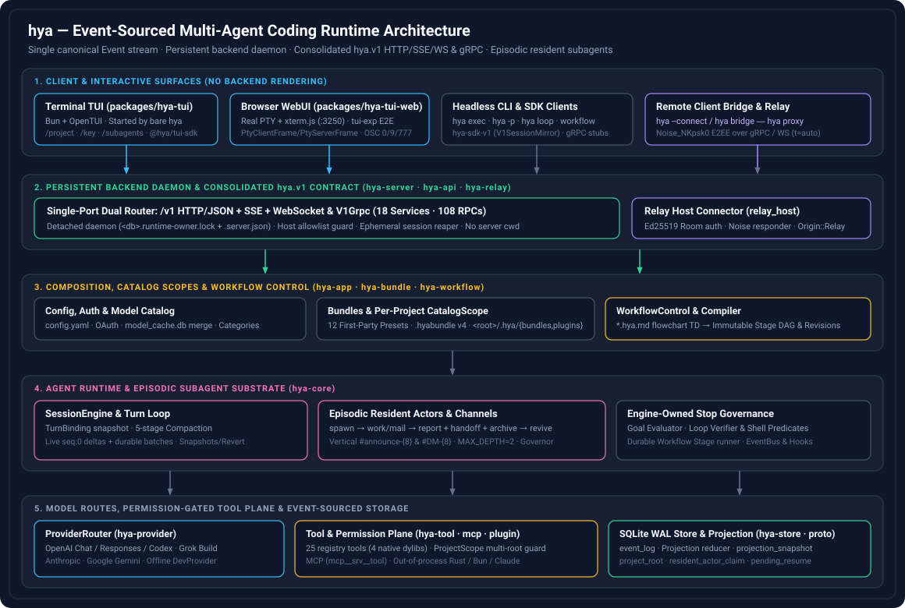

# What is Hya?

Hya is an AI coding assistant that runs on your computer. You open it in a project folder, ask it in plain English to read code, fix a bug, run tests, or write a new feature, and it does the work right in front of you.

You do not need an account with us, and nothing goes through our servers. Hya talks straight to whichever AI model provider you choose (Anthropic, OpenAI, Google, xAI, or a local model on your own machine).

Even before you add an API key, Hya starts up in **offline mode** using a built-in test model (`hya/offline`) that simply echoes back what you type. That means you can install Hya, open the app, and click around right away without paying a cent or setting up keys first.

## Two ways to look at the same chat: Terminal and Browser

When you run `hya` in a terminal, two things open at once:

1. **The Terminal UI (TUI)** right inside your terminal window.
2. **The WebUI** at `http://127.0.0.1:3250`, which draws the exact same interface inside your web browser.

Both connect to the same **background server** on your computer. Start a chat in your terminal, open `http://127.0.0.1:3250` in Chrome or Safari, and you will see the same chat updating live. If you close your terminal by accident, your chat keeps running in the background and your history is saved on disk.

## What Hya can do for you

- **Read, edit, and run commands safely.** Hya can search files, edit code, and run terminal commands like `npm test` or `cargo check`. By default, it asks your permission before running commands or touching files outside your project folder.
- **Undo mistakes in one command.** Did an edit go wrong? Run `/undo` and Hya rewinds both the chat message and the files it changed on disk.
- **Bring in helper agents.** For big jobs, Hya can spin up smaller helper agents (*subagents*) to search the codebase or work on subtasks in parallel, then report back to the main chat.
- **Run on autopilot from scripts.** Use `hya exec` for a quick one-off answer, `hya -p` to keep working until a goal passes a check, or `hya loop` to repeat until your test command succeeds.
- **Work from another computer.** Going out with just a laptop? Start Hya with a relay link (`hya serve start --relay ...`) and connect from anywhere (`hya --connect -`). Everything between your two machines is end-to-end encrypted.

## Ways to run Hya

| What you want to do | Command |
| --- | --- |
| Work interactively in your terminal + browser | `hya` |
| Connect Zed or another ACP-compatible code editor | `hya acp` (see [Editor Integration](../guide/editor-integration.md)) |
| Ask one question from a script and exit | `hya exec "explain what main.rs does"` |
| Keep working until a goal is finished | `hya -p "make all unit tests pass"` |
| Keep working until a shell test command passes | `hya loop --target "clean lint" --until "npm run lint"` |

## Where to go next

1. **[Install Hya](installation.md)** on Linux, macOS, or Windows (with WSL 2).
2. **[5-Minute Quickstart](quickstart.md)** to launch Hya, add an AI model key, and run your first task.
3. **[Common Workflows](common-workflows.md)** for everyday copy-paste examples.
