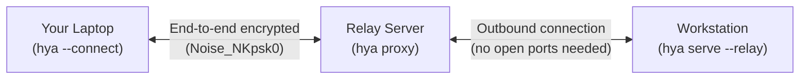

# Background Server & Remote Relay

Two things make Hya feel different from a plain terminal script:
1. **A persistent background server (*daemon*)** on your machine keeps your chats alive even when you close every window.
2. **An end-to-end encrypted Relay** lets you connect your laptop's TUI and WebUI to your desktop or cloud machine from anywhere—without opening firewall ports on your desktop or trusting the relay server with your code.

---

## 1. Managing the local background server (`hya serve`)

The first time you run `hya`, it automatically starts a background server tied to your session database (`~/.local/state/hya/sessions.db`). When you quit the TUI (`/exit` or `Ctrl+C` twice), the server stays running quietly in the background so your next `hya` launch is instant—and any background chat you left running with `Ctrl+D` keeps working.

You can check or control that server anytime:

```sh
hya serve status     # Show URL, PID, version, and uptime
hya serve restart    # Cleanly drain turns, restart the server, and reconnect open TUIs
hya serve stop       # Gracefully stop the background server
hya serve start      # Start it in the background without opening the TUI
```

> **One server per database:** Only one Hya server can own a `.db` file at a time (protected by an OS file lock so two processes can never corrupt your history). If you want a completely separate server instance for testing, pass `--db /path/to/other.db`.

---

## 2. Controlling a remote machine (`Secure Relay`)

Suppose your code, Docker containers, or GPUs live on a workstation at home or a cloud VM, and you want to work on them from a lightweight laptop at a coffee shop.

Hya's relay has three pieces:



- **`hya proxy`** runs on any reachable host (a $5 VPS, a Tailscale node, or behind Cloudflare Tunnel / Caddy / nginx). It is **completely blind**: it holds no keys, reads no config, and sees only encrypted bytes.
- **`hya serve --relay`** runs on your workstation and dials *out* to the proxy to register a private room.
- **`hya --connect -`** runs on your laptop, opens a local encrypted bridge, and launches your local TUI and WebUI against the remote workstation!

### Step-by-step setup

#### Step 1: Run `hya proxy` on a reachable server

```sh
hya proxy --port 8766
```

*(Putting nginx, Caddy, or Cloudflare Tunnel in front of it for HTTPS? That works great—and you can test your setup anytime with `hya relay doctor https://relay.example.com`.)*

#### Step 2: Connect your workstation's backend to the relay

On your workstation (the machine where your code lives):

```sh
hya serve start --relay https://relay.example.com
```

*(Already have a daemon running? Attach it live with `hya serve relay connect https://relay.example.com`.)*

This prints a **`hya://...` relay link** once. Copy it somewhere safe!

> [!CAUTION]
> **Treat the `hya://` link like an SSH private key.**
> Anyone holding that link has full control of your Hya backend (they can read files and run commands as your user). Never paste it into public chats or pass it directly on the command line where other users on a shared machine could see it in `ps`.

#### Step 3: Connect from your laptop

On your laptop, run:

```sh
hya --connect -
```

Paste the `hya://...` link when prompted (nothing is echoed to the screen) and press **Enter**.

Your terminal TUI and local browser WebUI (`http://127.0.0.1:3250`) open right up, connected to your workstation! Pick a Project with `/project` (it opens automatically on connect) and work just like you were sitting at your desk.

Already inside a local TUI and want to hop over to your remote machine? Just run:

```text
/connect-remote
```

And run `/disconnect-remote` whenever you want to switch back to your laptop's local server.

---

## Everyday relay commands

Run these on your **workstation** to check or rotate your remote access:

| Command | What it does |
| --- | --- |
| `hya serve relay status` | Check whether the backend is connected to the relay and how many streams are open |
| `hya serve relay link` | Print the current secret `hya://` link again |
| `hya serve relay rotate` | **Revoke the old link immediately** and generate a brand-new secret key |
| `hya serve relay disconnect` | Disconnect your workstation from the relay |
| `hya relay doctor <url>` | Test whether HTTP/2 gRPC and WebSockets work through your reverse proxy |
