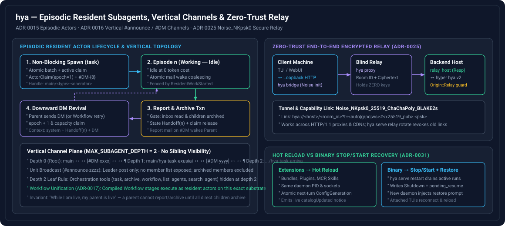

# Subagents & Multi-Agent Teams

When a job has several independent parts—like searching five folders at once, fixing two modules in parallel, or running a separate code review—Hya doesn't have to cram everything into one giant conversation. Instead, your main agent can spin up **helper agents** (*subagents*) to handle pieces of the job in their own clean context windows and report back.



---

## Built-in agent roles

Out of the box, Hya comes with five user-facing agent roles:

| Agent ID | Role | What it can do |
| --- | --- | --- |
| **`hya-main`** *(default)* | Main chat | Full coding agent—can read, edit, run commands, and delegate to helpers. |
| **`hya-plan`** | Main chat | **Read-only planner.** Explores code and writes a plan without touching files or running shell commands. Switch to it anytime with `/agent hya-plan`. |
| **`hya-task`** | Helper (`task` default) | General-purpose worker that can read, edit, run tests, and spawn one more layer of helpers if needed. |
| **`hya-scout`** | Helper | **Fast read-only researcher.** Searches and reads files quickly so your main chat doesn't fill up with raw search logs. |
| **`hya-reviewer`** | Helper | **Code reviewer.** Reads diffs and runs check commands, but is blocked from editing files. |

> **Tip:** Want `hya-scout` to run on a fast, cheap model while `hya-main` uses your strongest reasoning model? Open **`/agent`**, select `hya-scout`, and press **`m`** to give it its own model!

---

## How helper agents work

You don't need special syntax to use helpers—just ask naturally:

```text
Use two scout subagents in parallel: have one trace how auth tokens are issued, and have the other check how rate limiting works. Then summarize both.
```

Behind the scenes:

1. **Each helper gets a name** like `main/hya-scout-suzuran` and its own session log.
2. **Helpers work in the background** while the parent waits with `wait` (or continues other work). Up to two nested layers of helpers are supported (`main` → child → grandchild).
3. **Sleeping costs zero tokens.** When a helper finishes and calls `report`, Hya saves a short state summary (*handoff*) and puts the helper to sleep (*archived*).
4. **Follow-ups wake the same helper back up.** If your main agent (or you!) sends a follow-up question to `main/hya-scout-suzuran`, Hya wakes that exact helper back up with its saved handoff summary instead of starting from scratch.

---

## Watching and steering helpers (`/subagents`)

Whenever a `task` tool card appears in your chat, click it (or run **`/subagents`**) to open the **Subagents panes** right beside your conversation.

- **Browse live & finished helpers:** Use **Up/Down** in the selector pane to read any helper's live transcript on the right. Press **`Ctrl+A`** (or `/subagents archived`) to show helpers that already finished and archived.
- **Steer a helper directly:** Press **`s`** (or run `/subagents steer <session> <message>`) to send a direct instruction to a helper—this works even if the helper already finished and went to sleep!
- **Stop a runaway helper:** Press **`Esc`** on an empty input box (or `/subagents interrupt <session>`) to stop a running helper without killing your main chat.

---

## How agents talk to each other (Vertical Channels)

To prevent a noisy free-for-all where ten helpers talk over each other, Hya keeps agent messaging strictly **parent ⇄ child**:

- **Direct message (`#DM-...`):** Every parent and child share a private 1-on-1 channel created when the child starts.
- **Unit broadcast (`#announce-...`):** A parent can broadcast one update to all of its direct children at once. Sibling helpers never message each other sideways—everything flows cleanly through their parent.

---

## Tuning subagent limits (`config.yaml`)

By default, Hya caps how many helpers can run at once so one prompt doesn't accidentally burn through your rate limits. You can adjust those limits in `~/.config/hya/config.yaml`:

```yaml
subagents:
  max_concurrency: 100        # Max helpers streaming at the same time (1..=100)
  per_run_budget: 1024        # Max live helpers under one team root at once
  per_team_turn_budget: 1024  # Runaway safety cap on total helper turns
```
